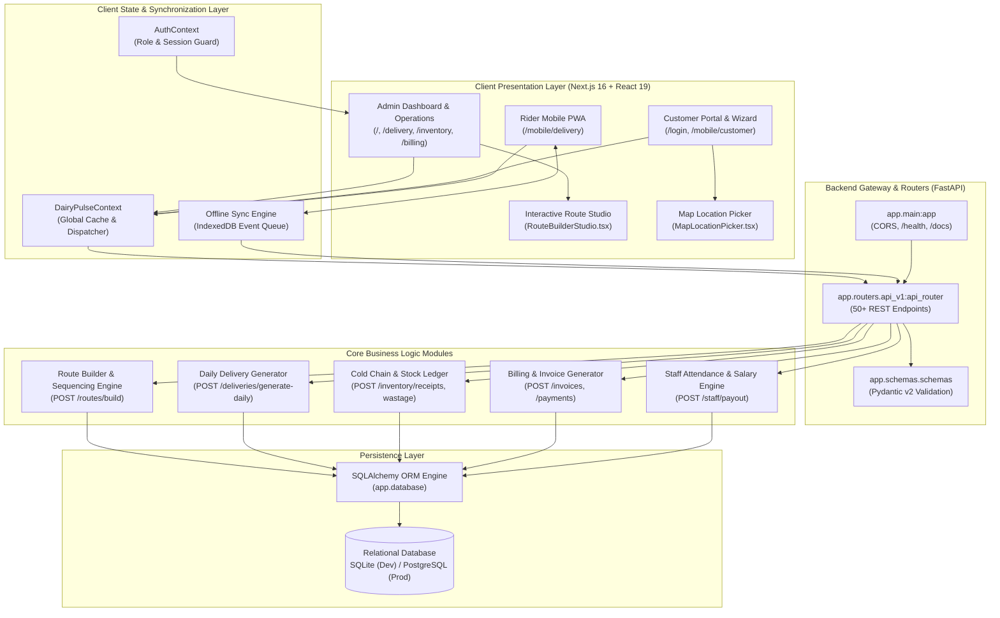
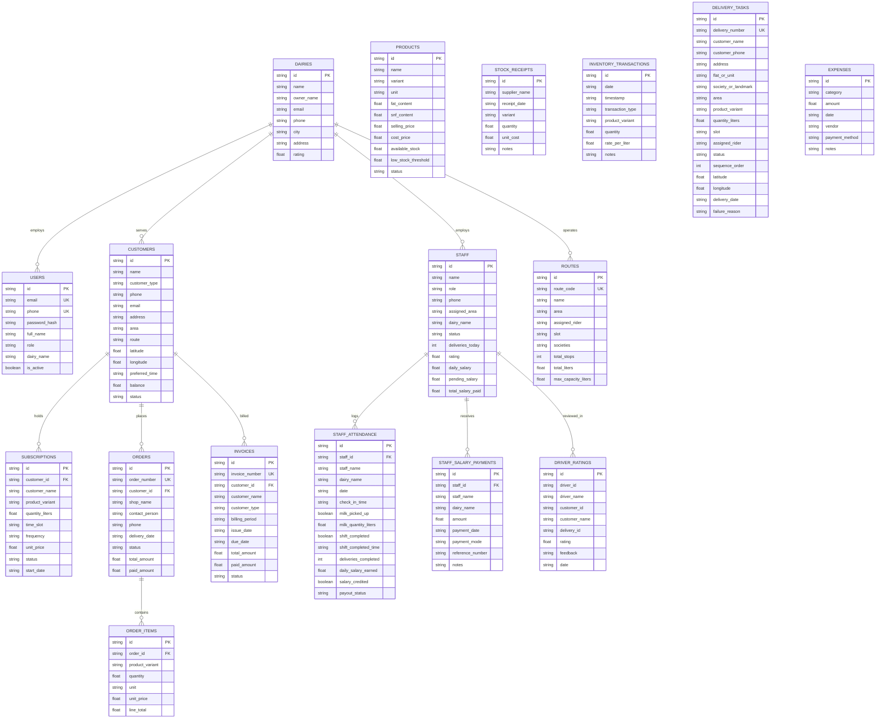
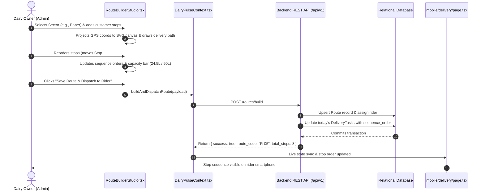
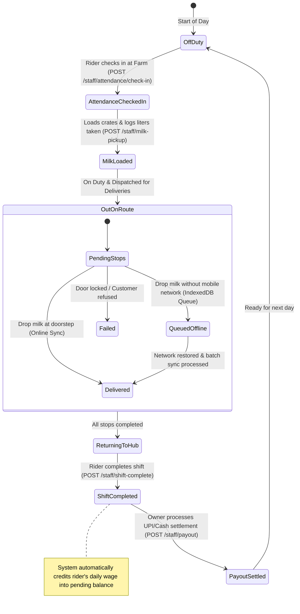
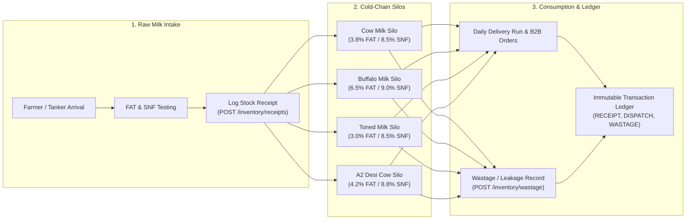
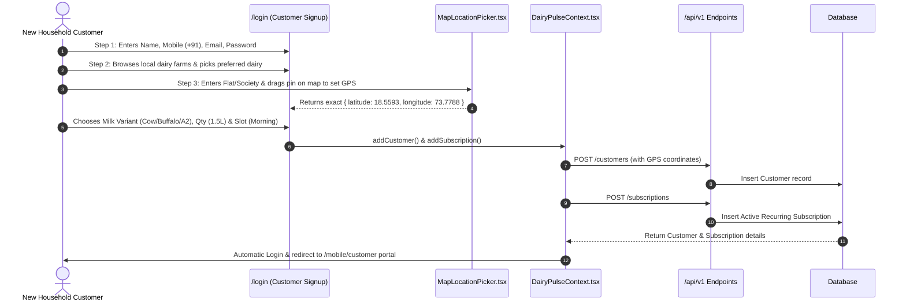
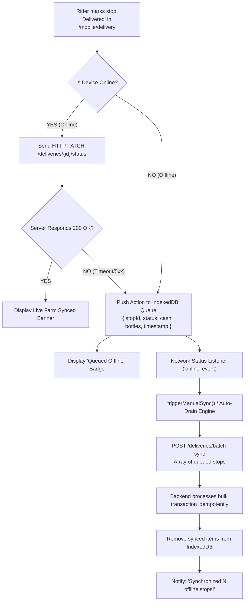

# DairyPulse — Complete System Diagrams & Technical Architecture

This comprehensive diagram collection provides a full visual blueprint of the DairyPulse platform, covering high-level architecture, database schema, end-to-end data flows, rider shift state machines, and offline-sync engines.

---

## 1. High-Level System Architecture Diagram

---

## 2. Complete Entity-Relationship (ER) Data Model

---

## 3. End-to-End Route Building & Live Dispatch Sequence

---

## 4. Rider Daily Shift & Compensation State Machine

---

## 5. Cold-Chain Milk Inventory & Quality Assurance Flowchart

---

## 6. Customer 3-Step Self-Service Onboarding Sequence

---

## 7. Offline-First Delivery Synchronization Architecture

