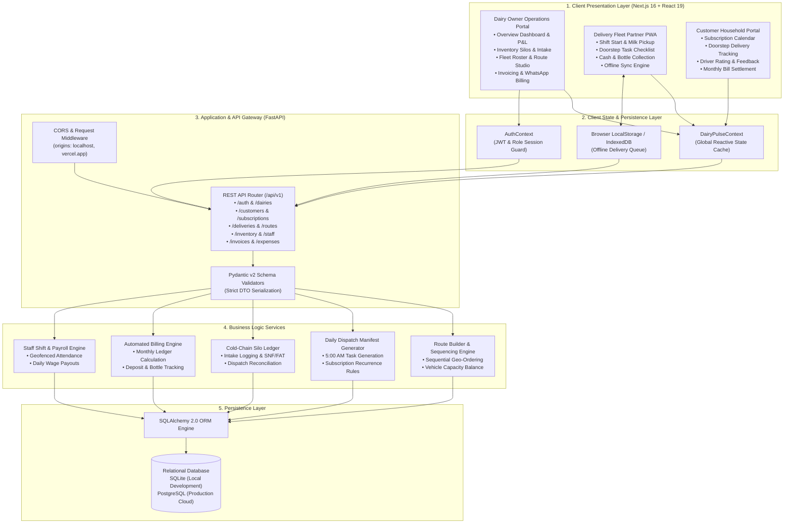
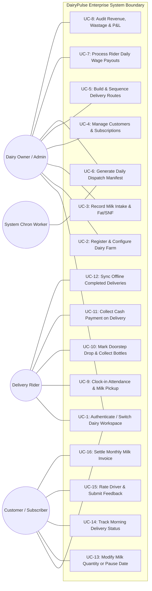
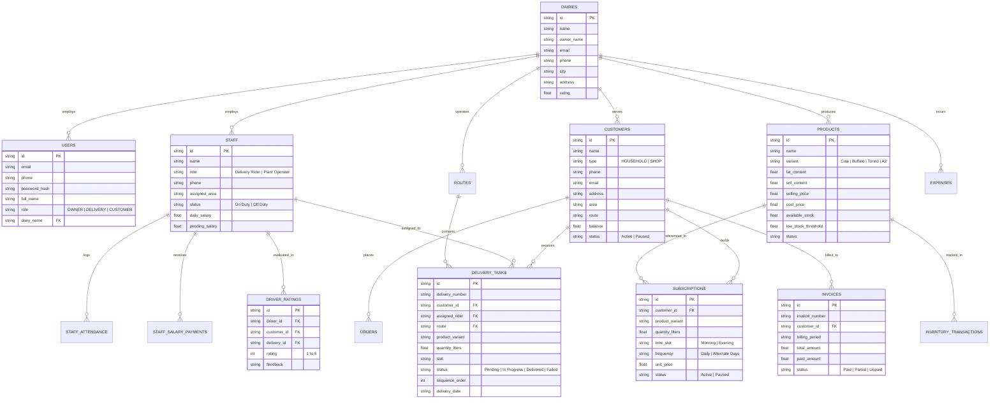
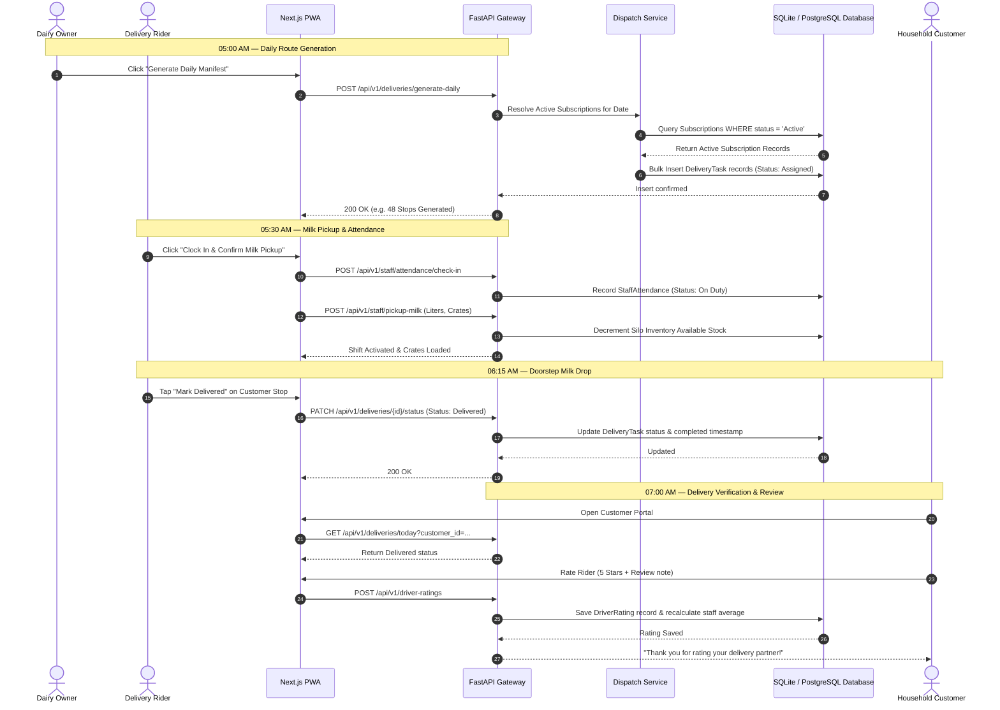
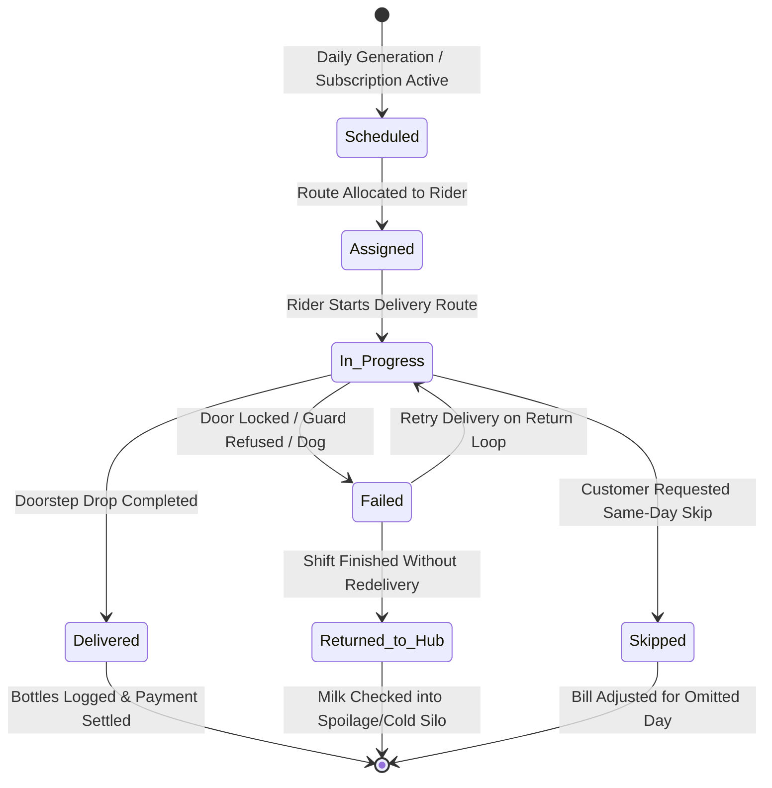
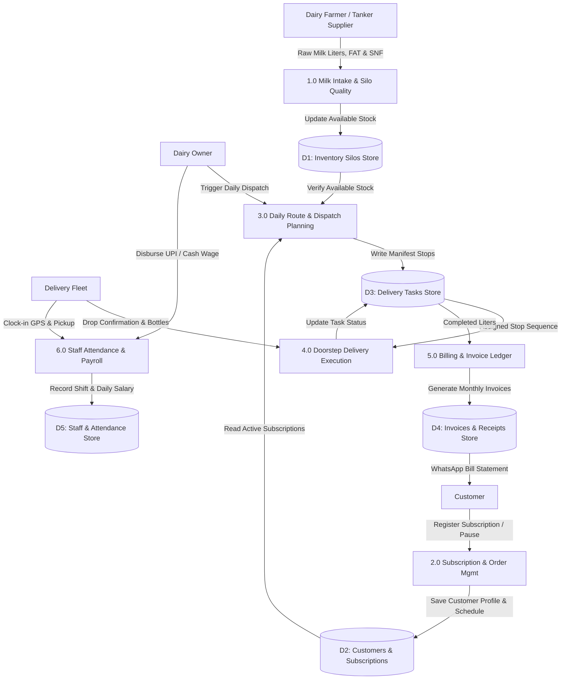

# DairyPulse — Complete Software Engineering UML & Architecture Diagrams

This document contains the complete software engineering visual specifications for **DairyPulse** (Multi-Dairy Farm & Supply Chain Operations Platform). These diagrams follow standard UML 2.5 and system engineering specifications, designed for academic Capstone evaluation and production architectural review.

---

## 1. System Architecture Diagram

---

## 2. Comprehensive System Use Case Diagram

---

## 3. Complete Entity-Relationship (ER) Diagram

---

## 4. Sequence Diagram: Morning Dispatch & Doorstep Fulfillment Flow

---

## 5. State Machine Diagram: Delivery Task Lifecycle

---

## 6. Data Flow Diagram (DFD Level 1: Core Operations)

