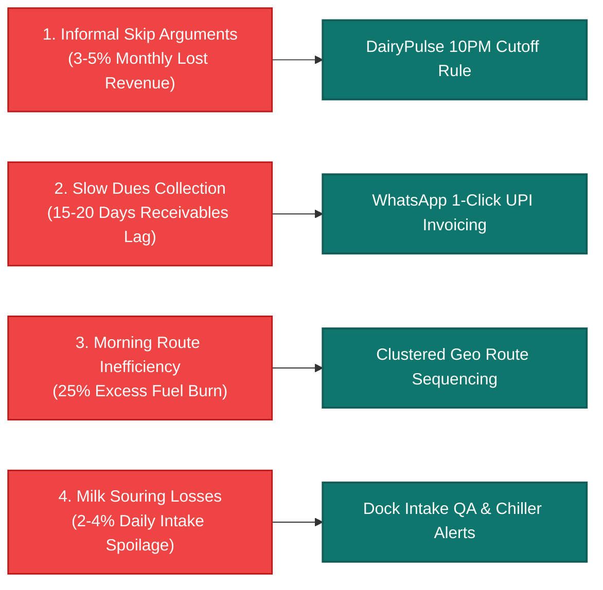

# Indian Dairy Industry: Market Research & Feasibility Analysis

## 1. Industry Macro Overview
- **World's Largest Milk Producer:** India accounts for ~24% of global milk production, producing over 230 million tonnes annually (DAHD Annual Report 2023–24).
- **Market Valuation:** The Indian dairy market reached ~₹16.7 lakh crore ($200B USD) in 2024 and is projected to expand at a CAGR of 13.5% through 2030 (IMARC Group).
- **The Organized vs. Unorganized Divide:**
  - **Organized (Co-operatives & Private Dairies):** 28–32% of total marketable milk.
  - **Unorganized (Local Dudhwala, informal village vendors, direct farm deliveries):** 68–72%.
- **Urban Shift:** Rapid growth in tier-1/tier-2 cities (Pune, Mumbai, Bengaluru, Hyderabad, Ahmedabad) towards direct-to-consumer (D2C) A2 cow milk, organic buffalo milk, and farm-fresh doorstep subscriptions.

---

## 2. Core Market Pain Points & Opportunities

---

## 3. Target Customer Segments in India
1. **Tier 1: Boutique Farm Dairies & Direct-to-Consumer Brands (500 – 5,000 Liters/day)**
   - Brands like *Sarda Farms*, *Gir Organic*, *Amrut Dairy*, delivering high-margin glass bottles (₹80–₹120/L).
   - High willingness to pay for customer mobile self-service and automated WhatsApp billing.
2. **Tier 2: Regional Independent Dairy Plants (2,000 – 25,000 Liters/day)**
   - Regional cooperative federations, local chilling centers, and multi-route pouch distributors.
   - Core value: Driver tracking, society sequence optimization, and procurement inventory control.
3. **Tier 3: Urban Delivery Route Operators (100 – 1,000 Pouches/day)**
   - Independent route contractors managing delivery riders across gated residential complexes.
   - Core value: Replacing paper registers, eliminating customer payment defaults.
