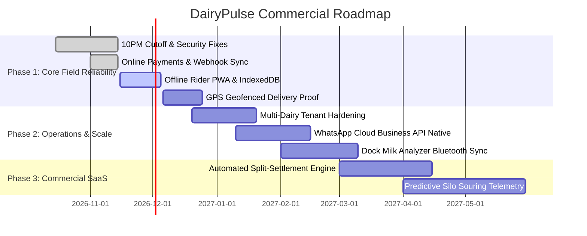

# DairyPulse Strategic Product Roadmap (2026–2027)

---

## Roadmap Phases

### Phase 1: Core Field Reliability & Cashflow (Q4 2026) - *CURRENT*
- **Milestone 1.1 (Complete):** 10:00 PM cutoff enforcement, Bcrypt password hashing, JWT authentication, and Razorpay/Cashfree order generation & verification.
- **Milestone 1.2:** Hardening the Delivery Rider mobile interface into an installable, offline-first PWA with IndexedDB background sync.
- **Milestone 1.3:** GPS-verified doorstep drop-off proof and customer photo confirmation for dispute elimination.

### Phase 2: Multi-Tenant Operational Hardening (Q1 2027)
- **Milestone 2.1:** Strict multi-tenant row-level security (RLS) enforcement across all API endpoints with `require_dairy_context` dependency.
- **Milestone 2.2:** Native Meta WhatsApp Business Cloud API integration for automated bill dispatch and interactive 1-tap customer pause/resume.
- **Milestone 2.3:** Bluetooth hardware integration with ultrasonic milk analyzers at collection docks.

### Phase 3: Marketplace & Commercial SaaS (Q2 2027)
- **Milestone 3.1:** Provider-approved automated payout splits and marketplace settlement architecture for independent dairy networks.
- **Milestone 3.2:** IoT chilling silo telemetry integration with automated cold-chain failure alarms.
