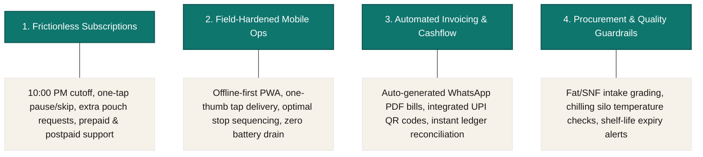

# DairyPulse Product Vision & Strategy

## 1. Executive Summary
DairyPulse is an AI-enabled, field-hardened dairy management and milk distribution ERP engineered specifically for India's regional milk cooperatives, private dairies, and doorstep subscription delivery networks.

In India, over 70% of fluid milk distribution remains semi-organized or unorganized, managed through manual paper registers, informal WhatsApp messages, and cash collections. This leads to 8–15% revenue leakage through unrecorded delivery skips, delayed payments, route theft, and milk souring.

DairyPulse digitizes the entire supply chain from dock milk procurement to 6:00 AM doorstep delivery pouch drop-offs, providing automated WhatsApp invoicing, UPI payment gateway reconciliation, dynamic route sequencing, and zero-bullshit operational clarity.

---

## 2. Core Pillars

---

## 3. Product Success Metrics (OKRs)
1. **Zero Cash Discrepancies:** Eliminate billing disputes between customers and dairy owners through immutable, auditable delivery logs.
2. **Sub-2-Second Rider Stop Logging:** Enable delivery riders to confirm doorstep delivery in under 2 taps, even with zero network connectivity in apartment basements.
3. **90%+ On-Time Payment Collection:** Drive customer bill settlement within 3 days of month-end via automated WhatsApp payment reminders and instant UPI gateway links.
4. **Sub-150ms API Latency:** Ensure snappy desktop dashboard and mobile PWA loading across budget devices and 3G/4G networks.

