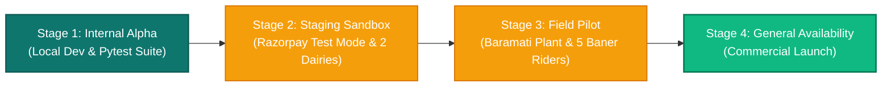

# DairyPulse Release Plan: Version 2.0 & Sprint 1

## 1. Release Version Overview
- **Target Release:** DairyPulse v2.0-MVP (Core Field Reliability Release)
- **Target Date:** December 2026
- **Release Manager:** Agent 36 (Release Manager)
- **Sign-off Gatekeepers:** CTO (Agent 3), QA Lead (Agent 28), Security Engineer (Agent 31).

---

## 2. Release Milestones & Rollout Stages

---

## 3. Staging Deployment Checklist
1. **Database Migrations:** Ensure SQLite and PostgreSQL migrations (`ensure_db_columns()`) run automatically on startup without data loss.
2. **Environment Variables:** Verify `.env` has valid values for `SECRET_KEY`, `RAZORPAY_KEY_ID`, `RAZORPAY_KEY_SECRET`, `SUPABASE_URL`.
3. **Automated Smoke Tests:** Execute all 43 backend tests and frontend static build (`npm run build`) with zero errors.
4. **Rollback Plan:** Stored git tag `v1.9.4-stable` with database snapshot script available in `scripts/backup_db.py`.
