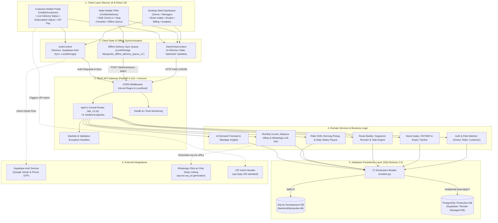
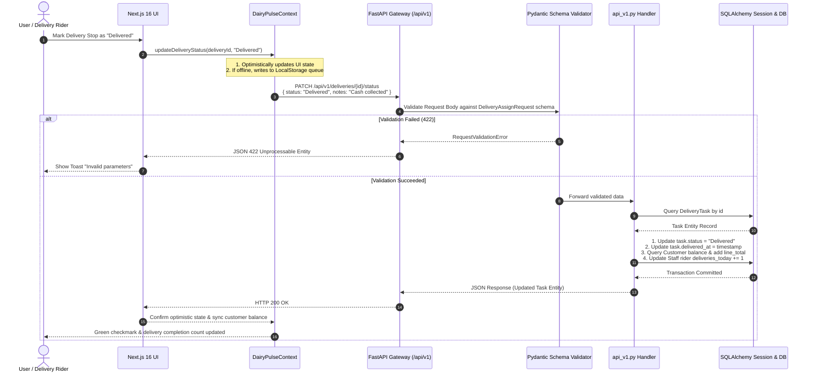
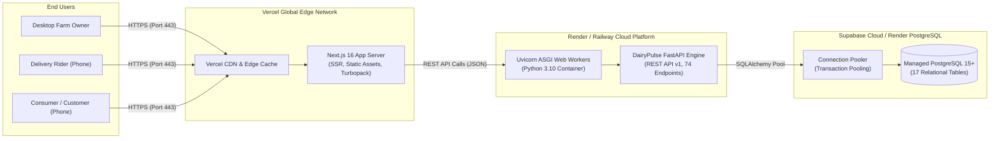

# Complete Architecture Specification — DairyPulse

> **Document Version:** 1.0.0  
> **Team:** NEXURA  
> **Scope:** High-Level Architecture, Multi-Tier Structure, Request-Response Lifecycle, Data Flow & Topology  

---

## 1. Architectural Philosophy

DairyPulse is architected around a **hybrid cloud-edge, micro-modular monolith** design pattern:
- **Presentation Layer:** Next.js 16 App Router client application offering high-speed responsive web dashboards for desktop operations and lightweight PWA touch interfaces for mobile users.
- **Service & Domain Layer:** Python FastAPI asynchronous REST service exposing domain-driven API contracts, handling business validation, route calculations, and heuristic analytics.
- **Persistence Layer:** SQLAlchemy 2.0 ORM decoupling the business logic from underlying database engines, supporting local zero-config SQLite (`dairypulse.db`) for testing/development and production-grade PostgreSQL (Supabase / Render) for multi-tenant deployment.
- **Offline Reliability:** Client-side optimistic state management with `localStorage` mutation queues and automatic background synchronization when delivery riders re-enter cellular network coverage.

---

## 2. High-Level System Architecture Diagram

---

## 3. Tier-by-Tier Architectural Breakdown

### 3.1 Presentation & UI Layer (`frontend/src`)
- **Next.js 16 App Router:** Utilizes directory-based routing (`frontend/src/app/`) where each operational domain is represented by a dedicated `page.tsx`.
- **Responsive Layout Shell (`frontend/src/components/layout/AppShell.tsx`):**
  - Evaluates user role from `AuthContext`.
  - Renders standalone full-screen containers for `CUSTOMER` and unauthenticated visitors (`/login`, `/register`).
  - Renders the responsive enterprise workspace with a collapsible sidebar and sticky top navigation for `OWNER` and operational staff.
- **Dual-State Sidebar (`frontend/src/components/layout/Sidebar.tsx`):**
  - **Expanded Mode (`isOpen === true`):** 256px (`w-64`) desktop drawer displaying full brand logo, farm identity badge, and icon + title navigation links.
  - **Collapsed Mode (`isOpen === false`):** 80px (`lg:w-20`) compact icon rail retaining the centered logo badge and navigation icons with hover tooltips (`title={item.label}`).
  - **Mobile Mode (`< 1024px`):** Off-canvas slide-out drawer with backdrop overlay that automatically closes upon stop selection.
  - **Persistence:** Sidebar state is stored in `localStorage` under `dairypulse_sidebar_open` so user preferences persist across page transitions and browser reloads.

### 3.2 Client State Architecture (`frontend/src/context`)
The frontend eliminates external heavyweight state libraries (such as Redux or MobX) in favor of three focused React Context providers:
1. **`AuthContext.tsx` (`407 lines`):** Manages user session state, local authentication persistence (`dairypulse_auth_user`), Supabase OAuth listener (`supabase.auth.onAuthStateChange`), and synchronization with the FastAPI backend via `syncSupabaseAuthApi()`.
2. **`DairyPulseContext.tsx` (`1,939 lines`):** Master data coordinator maintaining in-memory caches of products, customers, subscriptions, shop orders, today's deliveries, invoices, staff, routes, and ratings. Performs **optimistic UI updates** upon user action, then sends background HTTP requests to the backend.
3. **`ToastContext.tsx`:** Global non-blocking notification banner for success confirmations, error alerts, and network warnings.

### 3.3 Offline Synchronization Architecture (`frontend/src/lib/offlineSync.ts`)
- Designed specifically for rural and semi-urban delivery routes where delivery riders encounter sporadic 4G/5G connectivity.
- **Local Mutation Queue:** When a delivery status update is performed while offline (or simulated offline), the action is packaged as an `OfflineDeliveryAction` (containing `delivery_id`, `status`, `notes`, `bottles_returned`, `cash_collected`, `timestamp`, and `client_action_id`) and committed to `localStorage` under `dairypulse_offline_delivery_queue_v1`.
- **Auto-Reconnection Listener:** Browser event listeners (`window.addEventListener('online', ...)`) detect network resumption and automatically trigger `flushQueue()`.
- **Server Re-conciliation:** Batches all queued actions to `POST /api/v1/deliveries/sync-batch`. The backend processes each action within a single database transaction and returns an itemized sync summary.

### 3.4 REST API Layer (`backend/app/main.py` & `backend/app/routers/api_v1.py`)
- **FastAPI Framework:** Implements OpenAPI 3.1 documentation (`/docs` Swagger and `/redoc`) with strict Pydantic v2 schemas for all payload validation.
- **CORS Architecture (`backend/app/main.py#L125-L147`):**
  - Supports comma-separated origin whitelisting via the `ALLOWED_ORIGINS` environment variable.
  - Includes automated regular expression matching (`https://.*\.vercel\.app`) to seamlessly support Vercel preview branch deployments.
  - Provides a permissive fallback mode for local development.
- **Global Error Handling:**
  - `StarletteHTTPException`: Standardized JSON responses `{ detail, status_code }`.
  - `RequestValidationError`: Formats Pydantic 422 validation issues into readable messages.
  - `SQLAlchemyError`: Intercepts database exceptions, logs stack traces, and prevents SQL error leaking to the client.

### 3.5 Database & Persistence Layer (`backend/app/database.py` & `backend/app/models/models.py`)
- **Dialect Abstraction:** The SQLAlchemy engine dynamically detects the database URL scheme:
  - If `postgres://` or `postgresql://` is detected, it auto-normalizes the driver to `postgresql+psycopg2://` and configures connection pooling (`pool_size=10`, `max_overflow=20`, `pool_recycle=300`, `pool_pre_ping=True`).
  - If `sqlite:///` is detected, it applies `connect_args={"check_same_thread": False}` for local thread safety.
- **Session Lifecycle:** FastAPI's dependency injection (`Depends(get_db)`) guarantees a clean database session per request that is strictly closed in a `finally` block.
- **Startup Schema Migration (`backend/app/main.py#L27-L113`):**
  - Inspects tables using `PRAGMA table_info` and automatically runs safe `ALTER TABLE ADD COLUMN` statements to prevent breaking schema changes during iterative deployments without requiring manual migrations.

---

## 4. API Request-Response Lifecycle Diagram

---

## 5. Deployment Architecture Topology

This completes the structural and interaction architecture specification of DairyPulse. Subsequent documents detail the exact component and endpoint specifics.
