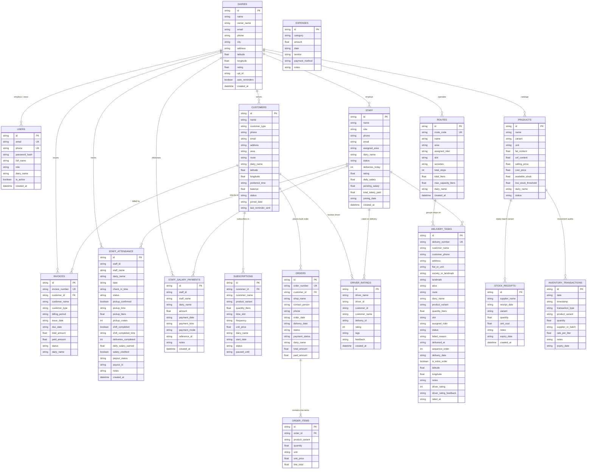

# Database Entity-Relationship (ER) Diagram — DairyPulse

> **Document Version:** 1.0.0  
> **Team:** NEXURA  
> **Dialect:** Mermaid ER Diagram  
> **Total Entities Represented:** 17  
> **Primary Keys:** UUID v4 String  

---

## 1. Complete System Entity-Relationship Diagram



---

## 2. Practical DairyPulse Entity Relationships Explained

### 2.1 The Daily Delivery & Ledger Pipeline
```
[Customer]
    │ 1
    ├── has many (1:N) ──> [Subscription] (e.g. 1.5L Cow Milk daily)
    │
    └── generate-daily ──> [DeliveryTask] (Assigned to Route & Rider)
                                │
                        Marked "Delivered"
                                │
                                └──> updates [Customer.balance] += (1.5L * ₹68 = ₹102)
                                └──> updates [Staff.deliveries_today] += 1
```
- **Example:** Customer "Priya Kulkarni" has an active `Subscription` for `1.5L` Cow Milk at `₹68/L`.
- Each morning, `POST /deliveries/generate-daily` instantiates a `DeliveryTask` sequenced on route `RT-WAKAD-01`.
- When rider "Rahul Deshmukh" taps "Mark Delivered" at 06:45 AM, the backend executes `customer.balance += 102.0`, updating Priya's monthly bill automatically.

---

### 2.2 The B2B Bulk Commercial Pipeline
```
[Customer (Type: SHOP)]
    │ 1
    └── places (1:N) ──> [Order] (e.g. ORD-2026-0891 to "Shree Krishna Sweets")
                            │ 1
                            └── contains (1:N) ──> [OrderItem] #1: 30L Buffalo Milk @ ₹78 = ₹2,340
                            └── contains (1:N) ──> [OrderItem] #2: 10L Cow Milk @ ₹68 = ₹680
                                                    Total = ₹3,020 (Payment: Pending)
```
- **Example:** Sweet shops and halwais require multi-product bulk deliveries with separate invoices and payment tracking distinct from household subscriptions.

---

### 2.3 The Rider Attendance & Payout Pipeline
```
[Staff (Rider)]
    │
    ├── checks in at 05:30 AM ──> [StaffAttendance] (check_in_time: "05:30 AM")
    ├── picks up crates       ──> [StaffAttendance] (pickup_liters: 72L, pickup_crates: 6)
    ├── completes 24 stops    ──> [StaffAttendance] (shift_completed: True, daily_salary_earned: ₹500)
    │                                 │
    │                       credits to [Staff.pending_salary] += ₹500
    │
    └── owner pays via UPI   ──> [StaffSalaryPayment] (amount: ₹3,500, mode: "UPI", ref: "UPI20261113009")
                                      │
                            debits [Staff.pending_salary] -= ₹3,500
                            credits [Staff.total_salary_paid] += ₹3,500
```
- This closed-loop payroll ensures farm owners never lose track of rider attendance, fuel allowances, or accumulated wages.

This completes the comprehensive visual and operational ER model documentation.
