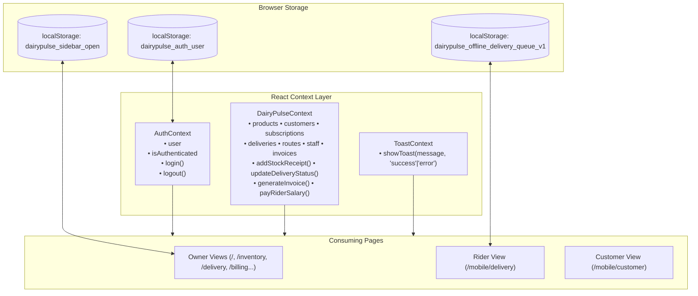

# Frontend Technical Documentation — DairyPulse

> **Document Version:** 1.0.0  
> **Team:** NEXURA  
> **Framework:** Next.js 16.4.2 (Turbopack) | React 19.3.0 | TypeScript 5 | Tailwind CSS 4  

---

## 1. Frontend Architectural Overview

The DairyPulse client is built with Next.js 16 utilizing the App Router architecture, providing server-rendered shells and lightning-fast client hydration. The user interface adheres strictly to high-tier agricultural tech aesthetics (deep teal `#0F766E`, `#2DD4BF`, warm stone neutrals `#151413`, `#1E1C1A`, and cream paper background `#FEFBF6`).

### Core Architectural Characteristics
1. **Zero External CSS Frameworks:** Pure Tailwind CSS v4 utility classes with custom semantic component styles.
2. **Context-Driven State Machine:** Unified operational data is stored and distributed via `DairyPulseContext`, while authentication and session state live in `AuthContext`.
3. **Optimistic Updates:** User actions update the local screen state instantly, followed by asynchronous REST requests to FastAPI.
4. **Resilient Network Handling:** Automatic fallback to local cache when the backend is restarting or unreachable.
5. **Mobile PWA First:** Responsive layouts adapt from 4K desktop screens down to 360px mobile viewport touchscreens.

---

## 2. Directory Structure of `frontend/src`

```
frontend/src/
├── app/                                  # Next.js 16 App Router Routes
│   ├── layout.tsx                        # Global root layout (font loading, AppShell wrapper)
│   ├── globals.css                       # Tailwind v4 theme, animations, utility classes
│   ├── not-found.tsx                     # Custom branded 404 page
│   ├── page.tsx                          # Owner Operations Dashboard (Desktop overview)
│   ├── login/page.tsx                    # Multi-role authentication & registration
│   ├── inventory/page.tsx                # Milk inventory, batches, FAT/SNF, wastage
│   ├── household/page.tsx                # Household subscriptions management
│   ├── orders/page.tsx                   # B2B restaurant and shop orders
│   ├── delivery/page.tsx                 # Daily delivery runs, rider dispatch, stop sequence
│   ├── routes/page.tsx                   # Delivery routes builder & rider assignment
│   ├── customers/page.tsx                # Customer directory, CRM, balances, history
│   ├── billing/page.tsx                  # Monthly invoices, payment ledger, dues
│   ├── staff/page.tsx                    # Staff roster, attendance, and salary payouts
│   ├── expenses/page.tsx                 # Farm operational expenses tracker
│   ├── reports/page.tsx                  # Revenue, volume, and business analytics
│   └── mobile/
│       ├── customer/page.tsx             # Standalone mobile customer portal
│       └── delivery/page.tsx             # Standalone mobile rider delivery portal
├── components/
│   ├── common/
│   │   └── PageHead.tsx                  # HTML meta title and OpenGraph tags
│   ├── layout/
│   │   ├── AppShell.tsx                  # Role-guarded shell with layout switching
│   │   ├── Sidebar.tsx                   # Dual-state desktop sidebar (w-64 & w-20 rail)
│   │   ├── TopNavbar.tsx                 # Search, notification center, farm switch, user menu
│   │   └── MobileBottomNav.tsx           # Mobile thumb navigation bar
│   ├── ui/                               # Reusable Atomic UI Component Library
│   │   ├── Badge.tsx                     # Status tags (success, warning, danger, info)
│   │   ├── Button.tsx                    # Button variants (primary, secondary, danger, ghost)
│   │   ├── Card.tsx                      # Standard container with title, subtitle, action slots
│   │   ├── StatCard.tsx                  # KPI summary metric box with trend indicator
│   │   ├── PageHeader.tsx                # Standardized view title banner with action button slot
│   │   ├── Tabs.tsx                      # Filter tab navigation with counters
│   │   ├── Input.tsx                     # Form field with label, error message, helper text
│   │   ├── ProgressBar.tsx               # Delivery progress bar visualizer
│   │   ├── Skeleton.tsx                  # Loading pulse placeholder
│   │   └── EmptyState.tsx                # Empty list illustration and call-to-action
│   ├── modals/
│   │   └── ModalContainer.tsx            # Global modal manager (dispatches activeModal by name)
│   ├── notifications/
│   │   ├── NotificationCenter.tsx        # In-app notifications drawer
│   │   └── NewCustomerOwnerAlert.tsx     # Toast modal alert when new customer registers
│   ├── customers/
│   │   ├── AddMilkModal.tsx              # Quick extra milk order modal
│   │   ├── CollectPaymentModal.tsx       # Record customer payment & clear balance
│   │   └── MonthEndWhatsAppModal.tsx     # Broadcast WhatsApp reminder with UPI QR
│   ├── subscriptions/
│   │   ├── AddSubscriptionModal.tsx      # Configure new milk subscription
│   │   └── FlexibleSubscriptionModal.tsx # Pause, resume, or modify daily milk quantity
│   └── delivery/
│       ├── DriverRatingModal.tsx         # 5-star rating dialog with compliment tags
│       ├── MapLocationPicker.tsx         # Interactive map pin picker for delivery address
│       └── RouteBuilderStudio.tsx        # Drag-and-drop stop reordering & route creator
├── config/
│   └── env.ts                            # Centralized environment variable reader
├── context/
│   ├── AuthContext.tsx                   # Role authentication & session state
│   ├── DairyPulseContext.tsx             # Master ERP operational state
│   └── ToastContext.tsx                  # Toast alert dispatcher
├── lib/
│   ├── api.ts                            # Typed HTTP client for all 74 FastAPI endpoints
│   ├── offlineSync.ts                    # LocalStorage offline delivery queue & batch sync
│   ├── supabaseClient.ts                 # Supabase client for Google OAuth & Phone OTP
│   └── calculations/
│       ├── delivery.ts                   # Delivery completion percentage math
│       └── salary.ts                     # Rider earnings & shift calculation
└── types/
    └── index.ts                          # Master TypeScript type definitions (35+ interfaces)
```

---

## 3. Comprehensive Page-by-Page Audit

### 3.1 Owner Dashboard Overview
- **File:** `frontend/src/app/page.tsx` (`473 lines`)
- **Route:** `/`
- **Purpose:** Central operational command center for the dairy owner / farm manager. Provides real-time snapshot of milk collection, inventory, delivery progress, today's sales, and pending dispatches.
- **Key Components Used:** `PageHeader`, `StatCard`, `Card`, `Badge`, `Button`, `Link`, Recharts charts, Lucide icons.
- **API Endpoints Called:**
  - `GET /api/v1/dashboard/summary`
  - `GET /api/v1/inventory/products`
  - `GET /api/v1/deliveries/today`
  - `GET /api/v1/orders`
  - `GET /api/v1/subscriptions`
- **Data Displayed:**
  - Today's Sales (₹) & order streams
  - Milk in Stock (Liters) & capacity utilization
  - Active Subscriptions count & daily volume
  - Delivery Completion percentage (`% done`) with Fleet Status indicator
  - Product stock levels table (Cow Milk, Buffalo Milk, Toned Milk)
  - Today's Route Stops table (Customer, Qty, Rider, Status)
  - Commercial & Shop Orders table (Shop, Contact, Items, Value)
- **User Actions:**
  - Click "Add Milk Intake" (opens `addStock` modal).
  - Click "View Dispatches" (navigates to `/delivery`).
  - Filter quick stats and view stop progress.

---

### 3.2 Milk Inventory & Quality
- **File:** `frontend/src/app/inventory/page.tsx` (`470 lines`)
- **Route:** `/inventory`
- **Purpose:** Track bulk milk procurement from farmers/suppliers, test and record FAT and SNF parameters, manage batch expiration dates, log milk processing, and audit wastage.
- **Key Components Used:** `Tabs`, `StatCard`, `Card`, `Badge`, `Button`, `ModalContainer`.
- **API Endpoints Called:**
  - `GET /api/v1/inventory/products`
  - `GET /api/v1/inventory/movements`
  - `POST /api/v1/inventory/receipts`
  - `POST /api/v1/inventory/wastage`
  - `PATCH /api/v1/inventory/movements/{id}/expiry`
  - `GET /api/v1/analytics/demand-forecast`
  - `GET /api/v1/analytics/wastage-insights`
- **Data Displayed:**
  - Available stock per variant (Cow, Buffalo, Toned, A2 Desi)
  - Quality metrics: FAT % (e.g. 4.2%), SNF % (e.g. 8.5%)
  - Stock receipts history with supplier name, rate/liter, and expiry date
  - AI demand prediction card showing predicted liters vs available stock
  - Wastage intelligence breakdown with financial loss calculations
- **User Actions:**
  - Log new milk receipt batch with supplier, liters, rate, and expiry date.
  - Record processing wastage or spoiled batch with reason.
  - Update expiry date on existing batches.

---

### 3.3 Household Subscriptions
- **File:** `frontend/src/app/household/page.tsx` (`350 lines`)
- **Route:** `/household`
- **Purpose:** Manage recurrent daily/alternate household milk subscriptions.
- **Key Components Used:** `Card`, `Badge`, `Button`, `Tabs`, `FlexibleSubscriptionModal`, `AddSubscriptionModal`.
- **API Endpoints Called:**
  - `GET /api/v1/subscriptions`
  - `POST /api/v1/subscriptions`
  - `PATCH /api/v1/subscriptions/{id}/toggle-pause`
  - `DELETE /api/v1/subscriptions/{id}`
  - `PATCH /api/v1/subscriptions/{id}/skip`
  - `PATCH /api/v1/subscriptions/{id}/modify-quantity`
  - `POST /api/v1/subscriptions/{id}/extra-milk`
- **Data Displayed:**
  - Customer name, address, society, assigned route
  - Variant, daily quantity (Liters), time slot (Morning / Evening)
  - Status badge (Active, Paused, Expired)
  - Paused-until date if temporarily suspended
- **User Actions:**
  - Create new milk subscription for a customer.
  - One-click pause/resume subscription.
  - Adjust daily delivery volume or skip specific dates.
  - Delete expired subscriptions.

---

### 3.4 Commercial & Shop Orders
- **File:** `frontend/src/app/orders/page.tsx` (`380 lines`)
- **Route:** `/orders`
- **Purpose:** Manage B2B orders for tea stalls, sweet shops (halwais), restaurants, and grocery retailers that order bulk milk and dairy products.
- **Key Components Used:** `Card`, `Badge`, `Button`, `Tabs`, `StatCard`.
- **API Endpoints Called:**
  - `GET /api/v1/orders`
  - `POST /api/v1/orders`
- **Data Displayed:**
  - Order number (`ORD-YYYY-XXXX`), shop name, contact person, phone
  - Order date, expected delivery date
  - Multi-line item list (variant, quantity, unit price, line total)
  - Payment status: `Paid`, `Partial`, `Pending`
  - Delivery status: `Pending`, `Dispatched`, `Delivered`, `Cancelled`
- **User Actions:**
  - Create bulk order with multiple dairy product line items.
  - Track payment and delivery fulfillment status.

---

### 3.5 Delivery Management & Dispatches
- **File:** `frontend/src/app/delivery/page.tsx` (`510 lines`)
- **Route:** `/delivery`
- **Purpose:** Morning and evening delivery dispatch desk. Generates daily stops from active subscriptions, assigns riders, and visualizes route fulfillment.
- **Key Components Used:** `ProgressBar`, `Card`, `Badge`, `Button`, `StatCard`, `Tabs`.
- **API Endpoints Called:**
  - `GET /api/v1/deliveries/today`
  - `POST /api/v1/deliveries/generate-daily`
  - `PATCH /api/v1/deliveries/{id}/status`
  - `PATCH /api/v1/deliveries/{id}/assign`
  - `PATCH /api/v1/deliveries/reorder`
  - `GET /api/v1/deliveries/optimized-route`
- **Data Displayed:**
  - Total scheduled stops, completed stops, pending stops, failed stops
  - Rider workload distribution (e.g. Rahul Deshmukh: 24 stops, 36L)
  - Stop sequence list with customer address, milk variant, quantity, delivery time
  - Failure reasons for undelivered stops (e.g. "Gate locked", "Customer unavailable")
- **User Actions:**
  - Click "Generate Today's Deliveries" to auto-populate stops from active subscriptions.
  - Reassign stops to a different rider or route.
  - Manually mark stops as Delivered or Failed.
  - Reorder stops using UP/DOWN sequence controls.

---

### 3.6 Route Builder Studio
- **File:** `frontend/src/app/routes/page.tsx` (`460 lines`)
- **Route:** `/routes`
- **Purpose:** Geographical route planning, capacity constraint enforcement (e.g., maximum crate capacity of 60L per bike/scooter), and society clustering.
- **Key Components Used:** `RouteBuilderStudio`, `Card`, `Badge`, `Button`, `MapLocationPicker`.
- **API Endpoints Called:**
  - `GET /api/v1/routes`
  - `POST /api/v1/routes`
  - `POST /api/v1/routes/build`
  - `POST /api/v1/deliveries/route-assign`
- **Data Displayed:**
  - Route code (`RT-WAKAD-01`), route name, area, assigned rider
  - Total customer stops, total liters, max capacity (Liters)
  - List of societies covered along the route
- **User Actions:**
  - Create new delivery route with designated rider and capacity limit.
  - Assign unassigned customers to specific route sequences.
  - Rebalance customer stops between overlapping routes.

---

### 3.7 Customer Directory & CRM
- **File:** `frontend/src/app/customers/page.tsx` (`841 lines`)
- **Route:** `/customers`
- **Purpose:** Complete customer registry, delivery history, outstanding balances, GPS coordinates, and WhatsApp billing reminders.
- **Key Components Used:** `CollectPaymentModal`, `AddMilkModal`, `MonthEndWhatsAppModal`, `DriverRatingModal`, `Card`, `Badge`, `Button`.
- **API Endpoints Called:**
  - `GET /api/v1/customers`
  - `GET /api/v1/customers/{id}`
  - `GET /api/v1/customers/{id}/delivery-history`
  - `POST /api/v1/customers`
  - `PATCH /api/v1/customers/{id}`
  - `POST /api/v1/billing/customers/{id}/whatsapp-reminder`
  - `GET /api/v1/ratings/driver/{driver_name}`
- **Data Displayed:**
  - Customer directory with search and area/type filtering (Household, Shop, Restaurant)
  - Selected customer profile: name, phone, address, route, joined date
  - Running ledger balance (`₹` outstanding)
  - 30-day delivery history table with timestamps and status
  - Driver ratings given by this customer
- **User Actions:**
  - Register new customer (triggers automated owner notification).
  - Open "Collect Payment" modal to record cash or UPI receipts.
  - Open "Month-End WhatsApp" modal to generate prefilled payment reminder with UPI QR.
  - View full past delivery audit trail.

---

### 3.8 Billing & Payment Ledger
- **File:** `frontend/src/app/billing/page.tsx` (`255 lines`)
- **Route:** `/billing`
- **Purpose:** Monthly invoice generation, dues tracking, collection rate metrics, and payment ledger reconciliation.
- **Key Components Used:** `StatCard`, `Card`, `Badge`, `Button`, `Tabs`.
- **API Endpoints Called:**
  - `GET /api/v1/invoices`
  - `POST /api/v1/invoices`
  - `POST /api/v1/invoices/{id}/payments`
  - `GET /api/v1/billing/monthly-due-reminders`
  - `POST /api/v1/billing/broadcast-whatsapp-reminders`
- **Data Displayed:**
  - Total Invoiced (₹), Total Collected (₹), Outstanding Balance (₹), Overdue Invoices count
  - Invoices table: Invoice number (`INV-2026-XXXX`), customer name, billing period, due date, amount, paid amount, status (`Paid`, `Partial`, `Unpaid`, `Overdue`)
- **User Actions:**
  - Generate new monthly invoice for a customer.
  - Record payment receipt against an invoice.
  - Filter invoices by status tabs.

---

### 3.9 Staff & Rider Management
- **File:** `frontend/src/app/staff/page.tsx` (`620 lines`)
- **Route:** `/staff`
- **Purpose:** Employee roster, delivery rider attendance, morning milk crate collection logs, daily salary accrual (`₹500/day`), and salary payout execution.
- **Key Components Used:** `Card`, `StatCard`, `Badge`, `Button`, `Tabs`, `ModalContainer`.
- **API Endpoints Called:**
  - `GET /api/v1/staff`
  - `POST /api/v1/staff`
  - `PATCH /api/v1/staff/{id}`
  - `GET /api/v1/attendance/today`
  - `GET /api/v1/attendance/list`
  - `POST /api/v1/salary/payout`
  - `GET /api/v1/salary/payouts`
  - `GET /api/v1/staff/{id}/salary-summary`
- **Data Displayed:**
  - Total staff, riders on duty, pending salary liabilities, total salary paid
  - Staff roster: name, role (Rider, Plant Operator, Manager), phone, assigned area, rating, daily salary rate
  - Attendance log: check-in time, crates picked up, deliveries completed, shift status
  - Salary payout history with UPI reference IDs
- **User Actions:**
  - Add or update staff member.
  - Adjust rider daily wage rate.
  - Record salary payout via UPI, Cash, or Bank Transfer.

---

### 3.10 Farm Expenses Tracker
- **File:** `frontend/src/app/expenses/page.tsx` (`280 lines`)
- **Route:** `/expenses`
- **Purpose:** Operational expense logging across feed, vehicle fuel, dairy plant maintenance, veterinary care, and packaging.
- **Key Components Used:** `StatCard`, `Card`, `Badge`, `Button`, `Tabs`.
- **API Endpoints Called:**
  - `GET /api/v1/expenses`
  - `POST /api/v1/expenses`
- **Data Displayed:**
  - Total expenses this month, category-wise breakdown (Cattle Feed, Fuel, Maintenance, Veterinary)
  - Expense ledger: Date, Category, Vendor, Amount (₹), Payment Method (UPI, Cash, Cheque), Notes
- **User Actions:**
  - Log new expense receipt with vendor and payment method.

---

### 3.11 Reports & Business Analytics
- **File:** `frontend/src/app/reports/page.tsx` (`340 lines`)
- **Route:** `/reports`
- **Purpose:** High-level executive reporting, monthly revenue charts, milk volume collection vs dispatch comparisons, and customer retention metrics.
- **Key Components Used:** Recharts (`ResponsiveContainer`, `AreaChart`, `BarChart`, `PieChart`), `Card`, `StatCard`, `Button`.
- **API Endpoints Called:**
  - `GET /api/v1/dashboard/summary`
  - `GET /api/v1/analytics/demand-forecast`
  - `GET /api/v1/analytics/wastage-insights`
  - `GET /api/v1/analytics/customer-insights`
- **Data Displayed:**
  - 30-day revenue trendline
  - Milk procurement vs sales volume balance
  - Customer retention & churn risk indicators
- **User Actions:**
  - Filter report date ranges.
  - Export CSV report data.

---

### 3.12 Customer Mobile PWA Portal
- **File:** `frontend/src/app/mobile/customer/page.tsx` (`310 lines`)
- **Route:** `/mobile/customer`
- **Purpose:** Standalone mobile web app designed specifically for consumers and households.
- **Key Components Used:** `Badge`, `Button`, `DriverRatingModal`, Lucide icons.
- **API Endpoints Called:**
  - `GET /api/v1/customers/{id}`
  - `GET /api/v1/customers/{id}/delivery-history`
  - `PATCH /api/v1/subscriptions/{id}/skip`
  - `POST /api/v1/subscriptions/{id}/extra-milk`
  - `POST /api/v1/ratings/driver`
- **Data Displayed:**
  - Today's Milk Delivery Status (Out for Delivery, Delivered at 06:45 AM)
  - Assigned rider name and phone with direct call button
  - Monthly milk account summary: liters consumed, current dues
  - One-click UPI payment button (`upi://pay?pa=...`) and QR code
  - Delivery history table with date, quantity, and status
- **User Actions:**
  - Tap "Need Extra Milk Tomorrow" to schedule an extra 1L/2L.
  - Tap "Pause / Skip Delivery" for vacation mode.
  - Tap "Rate Your Delivery Driver" to open 5-star feedback dialog.
  - Tap "Pay Bill via UPI" to open GPay, PhonePe, or Paytm.

---

### 3.13 Rider Mobile PWA Portal
- **File:** `frontend/src/app/mobile/delivery/page.tsx` (`560 lines`)
- **Route:** `/mobile/delivery`
- **Purpose:** Dedicated mobile delivery terminal for riders on bikes and delivery vans.
- **Key Components Used:** `ProgressBar`, `Badge`, `Button`, Lucide icons.
- **API Endpoints Called:**
  - `GET /api/v1/deliveries/today`
  - `POST /api/v1/attendance/check-in`
  - `POST /api/v1/attendance/pickup`
  - `PATCH /api/v1/deliveries/{id}/status`
  - `POST /api/v1/deliveries/sync-batch`
  - `POST /api/v1/attendance/complete-shift`
- **Data Displayed:**
  - Shift header: Start shift button, morning crate pickup verification (liters & crates)
  - Progress bar: Completed stops vs total stops (e.g. 18 / 24)
  - Turn-by-turn stop checklist with customer address, floor/flat number, bottle return count, and customer phone
  - Offline sync status pill (Online / Offline / Pending Actions)
  - Daily earnings indicator (e.g. `₹500.00 earned today`)
- **User Actions:**
  - Check in to morning shift.
  - Confirm milk crate pickup at the chilling center.
  - One-tap "Mark Delivered" or "Failed" (with reason selection).
  - Open customer location in Google Maps.
  - Tap to call customer or open WhatsApp chat.
  - Complete shift and view daily payout status.

---

### 3.14 Unified Login & Registration
- **File:** `frontend/src/app/login/page.tsx` (`420 lines`)
- **Route:** `/login`
- **Purpose:** Multi-role authentication portal with role tabs (Dairy Owner, Delivery Staff, Customer) supporting password authentication, Google OAuth, and Phone OTP.
- **Key Components Used:** `AuthContext`, `Input`, `Button`, `Badge`.
- **API Endpoints Called:**
  - `POST /api/v1/auth/login`
  - `POST /api/v1/auth/supabase-sync`
- **User Actions:**
  - Select role: `OWNER`, `DELIVERY`, or `CUSTOMER`.
  - Enter email/phone and password to authenticate.
  - Sign in via Google OAuth or Phone OTP.
  - Auto-redirects to appropriate portal upon successful login.

---

## 4. Reusable UI Component Library (`@/components/ui`)

| Component | File Path | Props & Capabilities |
|---|---|---|
| `Button` | `frontend/src/components/ui/Button.tsx` | Variants (`primary`, `secondary`, `danger`, `ghost`), sizes (`xs`, `sm`, `md`, `lg`), `isLoading` spinner state, `leftIcon`, `rightIcon`. |
| `Card` | `frontend/src/components/ui/Card.tsx` | Standard agricultural card with header, `title`, `subtitle`, `action` slot, and padded body. |
| `StatCard` | `frontend/src/components/ui/StatCard.tsx` | KPI metric display with large value, subtitle, icon, variant color (`teal`, `blue`, `amber`, `red`), and trend pill. |
| `Badge` | `frontend/src/components/ui/Badge.tsx` | Status pills with color variants (`success`, `warning`, `danger`, `info`, `neutral`), sizes (`xs`, `sm`, `md`), and pulsing `dot` indicator. |
| `PageHeader` | `frontend/src/components/ui/PageHeader.tsx` | Consistent page title banner with subtitle and optional right-aligned action buttons slot. |
| `Tabs` | `frontend/src/components/ui/Tabs.tsx` | Filter navigation tabs with active teal indicators and numerical counter badges. |
| `Input` | `frontend/src/components/ui/Input.tsx` | Accessible form text inputs with floating label support, validation error text, and left/right icon slots. |
| `ProgressBar` | `frontend/src/components/ui/ProgressBar.tsx` | Animated delivery route completion bar with custom color fills. |
| `Skeleton` | `frontend/src/components/ui/Skeleton.tsx` | Shimmer pulse placeholder for loading states. |
| `EmptyState` | `frontend/src/components/ui/EmptyState.tsx` | Visual placeholder when tables or lists contain zero items. |

---

## 5. State Management & Lifecycle



This completes the detailed frontend documentation.
