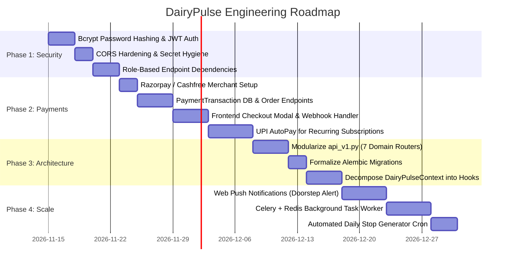

# Strategic Engineering & Implementation Roadmap — DairyPulse

> **Document Version:** 1.0.0  
> **Team:** NEXURA  
> **Target Release:** Version 2.0 Enterprise Production  
> **Timeline:** 4 Phased Milestones  

---

## 1. Roadmap Overview & Strategic Objectives

This engineering roadmap provides a structured, phased path to advance DairyPulse from its current high-functioning prototype state into a battle-tested, secure, enterprise-grade dairy platform ready for real commercial deployment across hundreds of farms.

---

## 2. Phase 1: Security Hardening & Zero-Trust Authentication
**Estimated Effort:** 8 Days  
**Business Priority:** **P0 (Immediate Blockers)**  

1. **Implement Salted Bcrypt Password Hashing:**
   - Integrate `passlib[bcrypt]` in `app/routers/auth.py`.
   - Update `User` and `Staff` password storage to write one-way salted hashes (`$2b$12$...`).
   - Eliminate plaintext comparison and close password bypass vulnerabilities.
2. **Issue Dynamic, Cryptographically Signed JWT Tokens:**
   - Mint standard JWT tokens containing `sub` (user_id), `role`, `dairy_name`, and `exp` claims signed with `settings.SECRET_KEY`.
   - Implement `get_current_user` dependency in FastAPI to validate bearer tokens on protected routes.
3. **Enforce Role-Based Access Control (RBAC):**
   - Restrict financial endpoints (`/invoices`, `/salary/payout`, `/billing/*`) strictly to users with `role == "OWNER"`.
   - Restrict rider endpoints (`/attendance/*`, `/deliveries/sync-batch`) to `role in ["DELIVERY", "OWNER"]`.
4. **Environment Secret Hygiene:**
   - Remove hardcoded fallback secret keys in `config.py` and `env.ts`. Fail closed if production keys are missing.
   - Restrict production CORS exclusively to verified frontend origins.

---

## 3. Phase 2: Production Online Payment Gateway Integration
**Estimated Effort:** 15 Days  
**Business Priority:** **P0 (Commercial Revenue Enabler)**  
**Target Category:** `Ecommerce/Retail -> Dairy Products Stores`  

1. **Merchant Onboarding & Gateway Setup:**
   - Register DairyPulse merchant profile on Razorpay / Cashfree under Dairy Products Stores.
   - Configure test mode credentials (`RAZORPAY_KEY_ID`, `RAZORPAY_KEY_SECRET`).
2. **Database Schema Delta:**
   - Add `PaymentTransaction` model to record `gateway_order_id`, `gateway_payment_id`, `amount`, `currency`, `status`, and `gateway_signature`.
3. **Order Creation & Verification Endpoints:**
   - `POST /api/v1/payments/create-order`: Generates gateway order ID and stores pending transaction record.
   - `POST /api/v1/payments/verify`: Verifies HMAC-SHA256 signature, updates invoice status to `Paid`, and credits customer balance.
4. **Secure Webhook Handler:**
   - `POST /api/v1/payments/webhook`: Listens for asynchronous `payment.captured` and `payment.failed` events to guarantee zero lost payments even if customer closes browser prematurely.
5. **Frontend Checkout Integration:**
   - Add "Pay Online" modal to `/billing` and `/mobile/customer` using Razorpay Standard Checkout SDK.
6. **UPI AutoPay for Recurring Subscriptions:**
   - Implement Razorpay Subscriptions / UPI AutoPay to enable automated monthly milk bill debits.

---

## 4. Phase 3: Architectural Modularization & Clean Code
**Estimated Effort:** 10 Days  
**Business Priority:** **P1 (Maintainability & Scalability)**  

1. **Decompose `api_v1.py` into Domain Sub-Routers:**
   - Split 3,001-line file into:
     - `app/routers/auth.py`
     - `app/routers/inventory.py`
     - `app/routers/customers.py`
     - `app/routers/subscriptions.py`
     - `app/routers/deliveries.py`
     - `app/routers/billing.py`
     - `app/routers/staff.py`
     - `app/routers/analytics.py`
2. **Migrate from SQLite PRAGMAs to Formal Alembic Scripts:**
   - Remove `ensure_db_columns()` in `main.py`.
   - Generate version-controlled Alembic migrations under `backend/alembic/versions/`.
3. **Decompose `DairyPulseContext.tsx`:**
   - Break 1,939-line provider into modular custom hooks (`useDeliveries`, `useBilling`, `useCustomers`) to minimize unnecessary component re-renders.

---

## 5. Phase 4: Production Scale & Intelligent Automation
**Estimated Effort:** 13 Days  
**Business Priority:** **P2 (Operational Excellence)**  

1. **Web Push Doorstep Notifications:**
   - Integrate Web Push API with Service Worker.
   - When rider marks a stop as `Delivered`, send an instant push notification: *"Your morning fresh milk has been placed at your door."*
2. **Automated Daily Shift Dispatch Engine (Celery + Redis):**
   - Deploy background task worker with Celery and Redis.
   - Automatically trigger `POST /deliveries/generate-daily` at 04:00 AM every morning without requiring manual owner button clicks.
3. **WhatsApp Business Cloud API:**
   - Upgrade from `wa.me` manual click-to-chat links to direct Meta WhatsApp Business API for automated monthly PDF bill delivery with embedded payment buttons.

---

This roadmap provides an actionable, prioritize-driven path to take DairyPulse to market leadership.
