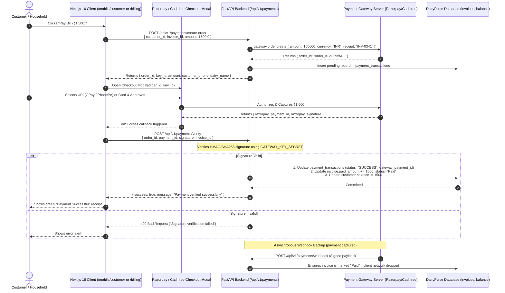

# Payment System Analysis & Online Gateway Blueprint — DairyPulse

> **Document Version:** 1.0.0  
> **Team:** NEXURA  
> **Merchant Category:** `Ecommerce/Retail -> Dairy Products Stores` (or `Grocery & Supermarkets`)  
> **Scope:** Audit of Existing Billing/Payment Code, Reusable Assets, and Complete Production Online Gateway Implementation Plan  

---

## 1. Executive Context: Why This Analysis Matters

The user is preparing to register DairyPulse for an Indian payment gateway merchant account (such as **Razorpay**, **Cashfree**, or **Paytm**), selecting the standard merchant category:
> **`Ecommerce/Retail -> Dairy Products Stores`**

Before introducing any new payment gateway SDK or database tables, this document maps out every existing line of payment, invoice, and ledger code in DairyPulse. This ensures existing offline, UPI QR, and cash payment capabilities remain 100% operational while online payment collection is seamlessly added.

---

## 2. Inventory of Existing Payment Capabilities in Source Code

### 2.1 Existing Payment & Billing Database Entities (`backend/app/models/models.py`)
| Entity Name | Table Name | Existing Payment-Related Fields | Source Location |
|---|---|---|---|
| **`Invoice`** | `invoices` | `total_amount` (`Float`), `paid_amount` (`Float`, default: `0.0`), `status` (`String`: `"Paid"`, `"Partial"`, `"Unpaid"`, `"Overdue"`), `due_date`, `billing_period`. | `models.py#L247-L264` |
| **`Customer`** | `customers` | `balance` (`Float`, default: `0.0`, represents cumulative unpaid dues in ₹), `last_reminder_sent` (`String`). | `models.py#L68-L91` |
| **`Order`** | `orders` | `total_amount` (`Float`), `paid_amount` (`Float`), `payment_status` (`String`: `"Paid"`, `"Partial"`, `"Pending"`). | `models.py#L153-L172` |
| **`StaffSalaryPayment`** | `staff_salary_payments` | `amount` (`Float`), `payment_mode` (`"UPI"`, `"Cash"`, `"Bank Transfer"`), `reference_id` (`String`, for UPI UTR / bank ref), `payment_date`, `payment_time`. | `models.py#L300-L313` |
| **`Dairy`** | `dairies` | `upi_id` (`String`, default: `"dairypulse@okhdfcbank"`), `auto_reminders` (`Boolean`). | `models.py#L19-L35` |
| **`Expense`** | `expenses` | `amount` (`Float`), `payment_method` (`"UPI"`, `"Cash"`, `"Bank Transfer"`, `"Cheque"`). | `models.py#L265-L275` |

---

### 2.2 Existing Payment API Endpoints (`backend/app/routers/api_v1.py`)
1. **Record Payment Against Invoice:**
   - `POST /api/v1/invoices/{invoice_id}/payments` (`api_v1.py#L1404`)
   - **Payload:** `PaymentRecord { amount: float }`
   - **Business Logic:** Increments `invoice.paid_amount`. If `paid_amount >= total_amount`, sets status to `"Paid"`. Simultaneously debits the customer's cumulative running balance (`customer.balance -= amount`).
2. **List Invoices Ledger:**
   - `GET /api/v1/invoices` (`api_v1.py#L1371`)
   - Returns all customer invoices with paid amount, outstanding balance, and overdue tags.
3. **Generate Customer Invoice:**
   - `POST /api/v1/invoices` (`api_v1.py#L1378`)
   - Generates a formal invoice entity from accumulated monthly deliveries.
4. **Month-End Due Reminders & UPI Intent Link Generator:**
   - `GET /api/v1/billing/monthly-due-reminders` (`api_v1.py#L3129`)
   - Scans all customers with `balance > 0`.
   - Constructs a standardized Indian UPI Intent URI:
     ```
     upi://pay?pa={dairy.upi_id}&pn={dairy.name}&am={customer.balance}&cu=INR&tn=Milk+Bill+Payment
     ```
   - Generates a pre-formatted WhatsApp reminder text containing billing details and the UPI payment link:
     ```
     https://wa.me/91{clean_phone}?text={encoded_message}
     ```
5. **Staff Wage Payouts:**
   - `POST /api/v1/salary/payout` (`api_v1.py#L2908`)
   - Disburses accumulated rider earnings and logs the payout transaction mode (`UPI`, `Cash`, `Bank Transfer`).

---

### 2.3 Existing Frontend Payment UI Components
1. **Billing & Invoices Ledger (`frontend/src/app/billing/page.tsx`):**
   - KPI metric stat cards: **Total Invoiced**, **Total Collected**, **Outstanding Balance**, and **Overdue Count**.
   - Tabbed invoice status filtering (`All`, `Paid`, `Partial`, `Unpaid`, `Overdue`).
2. **Collect Payment Modal (`frontend/src/components/customers/CollectPaymentModal.tsx`):**
   - Dialog allowing farm owners or riders to record offline cash or direct UPI payments, instantly clearing the customer's balance.
3. **Month-End WhatsApp Billing Modal (`frontend/src/components/customers/MonthEndWhatsAppModal.tsx`):**
   - Broadcast interface displaying outstanding dues per customer, showing the dairy's active UPI ID (`dairypulse@okhdfcbank`), dynamic UPI QR code generator, and a one-click button to open WhatsApp Web/App with prefilled payment instructions.
4. **Customer Mobile Portal (`frontend/src/app/mobile/customer/page.tsx`):**
   - Mobile billing card showing current month's milk liters, amount due, and a direct "Pay Bill via UPI" deep-link button that opens Google Pay, PhonePe, or Paytm directly on the customer's phone.

---

## 3. What Is Currently Missing for Full Online Gateway Payments

While the offline and direct UPI intent workflow is fully operational, the following components are required for an automated online payment gateway (e.g., Razorpay or Cashfree):

| Component | Current State | Required for Online Gateway |
|---|---|---|
| **Gateway Python SDK** | Not in `requirements.txt` | Add `razorpay>=1.4.0` or `cashfree-pg>=3.0.0` |
| **Frontend Checkout SDK** | Not in `package.json` | Add `razorpay` script checkout or `@cashfreepayments/cashfree-js` |
| **Order Creation Endpoint** | None | `POST /api/v1/payments/create-order` (calls Gateway API to get `order_id`) |
| **Payment Verification Endpoint** | None | `POST /api/v1/payments/verify` (verifies HMAC-SHA256 signature) |
| **Webhook Handler** | None | `POST /api/v1/payments/webhook` (asynchronous capture, refund & failure alerts) |
| **Payment Transactions Table** | None (logged directly on invoice) | Dedicated `PaymentTransaction` table to store gateway payment IDs, fees, and timestamps |
| **Refund Engine** | Manual balance delta only | `POST /api/v1/payments/refund` with gateway automated refund initiation |

---

## 4. Production Online Payment Gateway Architecture Blueprint

### 4.1 Recommended Gateway Choice
For the category **`Ecommerce/Retail -> Dairy Products Stores`**:
- **Primary Choice:** **Razorpay** (Supports UPI AutoPay, Recurring Subscriptions, GPay, PhonePe, Netbanking, Cards, Instant WhatsApp payment links).
- **Secondary Choice:** **Cashfree** (Lower UPI transaction fees, automated vendor splits for dairy farmers).

### 4.2 Online Payment Flow Sequence Diagram



---

## 5. Proposed Database Schema Delta for Online Payments

To maintain pristine auditability and financial record integrity, add this single model to `backend/app/models/models.py`:

```python
class PaymentTransaction(Base):
    __tablename__ = "payment_transactions"

    id = Column(String, primary_key=True, default=generate_uuid)
    customer_id = Column(String, ForeignKey("customers.id"), nullable=False)
    invoice_id = Column(String, ForeignKey("invoices.id"), nullable=True)
    gateway_order_id = Column(String, unique=True, nullable=False)
    gateway_payment_id = Column(String, unique=True, nullable=True)
    amount = Column(Float, nullable=False)
    currency = Column(String, default="INR")
    status = Column(String, default="PENDING")  # PENDING, SUCCESS, FAILED, REFUNDED
    payment_method = Column(String, nullable=True)  # UPI, CARD, NETBANKING
    gateway_signature = Column(String, nullable=True)
    error_message = Column(Text, nullable=True)
    dairy_name = Column(String, default="Amrut Dairy Farm", nullable=True)
    created_at = Column(DateTime, default=datetime.utcnow)
```

---

## 6. Existing Reusable Code Summary

When implementing the online gateway, **DO NOT delete or rewrite**:
1. `backend/app/routers/api_v1.py#L1404` (`POST /invoices/{id}/payments`): Keep this intact as the manual/offline payment logger.
2. `frontend/src/components/customers/CollectPaymentModal.tsx`: Keep this intact for riders collecting cash at the doorstep.
3. `backend/app/routers/api_v1.py#L3129` (`GET /billing/monthly-due-reminders`): Keep this intact for zero-fee direct UPI peer-to-peer WhatsApp links.
4. `frontend/src/app/billing/page.tsx`: Reuse the existing invoice table, KPI stat cards, and status filters; simply hook the new "Pay Online" modal button into the invoice row actions.

This provides the exact architecture and codebase blueprint to register with your payment gateway provider under **Dairy Products Stores** and execute the integration smoothly.
