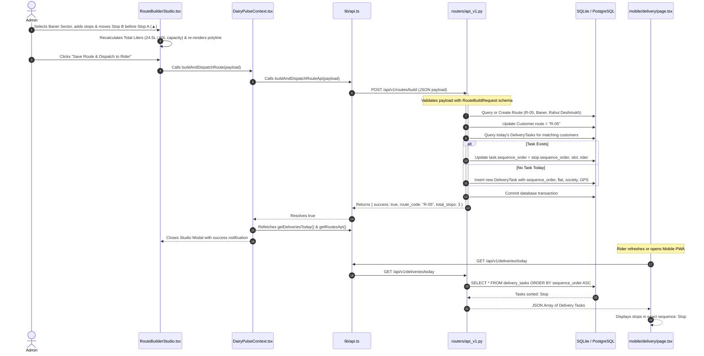

# DairyPulse — System Architecture & Component Interactions

This document explains the real architectural patterns, system boundaries, and data flow mechanisms implemented in DairyPulse.

---

## 1. Architectural Pattern: Layered Client-Server with Offline-Resilient Edge

DairyPulse follows a **Decoupled Layered Client-Server Architecture** with an **Offline-Capable Client State Layer**:
1. **Presentation & Application Layer (Frontend)**: Next.js 16 App Router application managing client views, role-based interfaces (Admin, Rider PWA, Customer Portal), and interactive SVG map projections.
2. **Client State & Offline Layer**: A React Context provider (`DairyPulseContext`) paired with an IndexedDB storage queue (`useOfflineDeliverySync`) providing optimistic updates and fault-tolerant background synchronization.
3. **API & Service Gateway (Backend)**: FastAPI application providing stateless RESTful endpoints, request validation through Pydantic v2 schemas, and dependency-injected database sessions.
4. **Data Persistence Layer (Database)**: SQLAlchemy ORM layer abstracting transactional database operations over SQLite (development) or PostgreSQL (production).

---

## 2. Real System Component Diagram

```mermaid
graph TB
    subgraph ClientLayer ["Client Presentation Layer (Next.js 16 + React 19)"]
        AdminDashboard["Admin Dashboard & Operations<br/>(/, /delivery, /inventory, /billing)"]
        CustomerWiz["Customer Portal & Wizard<br/>(/login, /mobile/customer)"]
        RiderPWA["Rider Mobile PWA<br/>(/mobile/delivery)"]
        RouteStudio["Interactive Route Studio<br/>(RouteBuilderStudio.tsx)"]
        MapPicker["Map Location Picker<br/>(MapLocationPicker.tsx)"]
    end

    subgraph StateLayer ["Client State & Synchronization Layer"]
        Context["DairyPulseContext<br/>(Global Cache & Dispatcher)"]
        AuthCtx["AuthContext<br/>(Role & Session Guard)"]
        OfflineQueue["Offline Sync Engine<br/>(IndexedDB Event Queue)"]
    end

    subgraph APILayer ["Backend Gateway & Routers (FastAPI)"]
        MainApp["app.main:app<br/>(CORS, /health, /docs)"]
        APIRouter["app.routers.api_v1:api_router<br/>(25+ Endpoints)"]
        Schemas["app.schemas.schemas<br/>(Pydantic Validation)"]
    end

    subgraph ServiceLogic ["Core Business Logic Modules"]
        RouteEngine["Route Builder & Sequencing Engine<br/>(POST /routes/build)"]
        DailyDispatcher["Daily Delivery Generator<br/>(POST /deliveries/generate-daily)"]
        InventoryLedger["Cold Chain & Stock Ledger<br/>(POST /inventory/receipts, wastage)"]
        BillingEngine["Billing & Invoice Generator<br/>(POST /invoices, /payments)"]
    end

    subgraph StorageLayer ["Persistence Layer"]
        DBEngine["SQLAlchemy Engine<br/>(app.database)"]
        DB[(Relational DB: SQLite / PostgreSQL)]
    end

    %% Client Interactions
    AdminDashboard --> Context
    CustomerWiz --> Context
    CustomerWiz --> MapPicker
    AdminDashboard --> RouteStudio
    RiderPWA --> Context
    RiderPWA <--> OfflineQueue

    %% State to API
    Context -->|HTTP Fetch (JSON)| APIRouter
    AuthCtx -->|Session Storage| AdminDashboard
    OfflineQueue -->|Auto Retry Sync| APIRouter

    %% API to Logic
    MainApp --> APIRouter
    APIRouter --> Schemas
    APIRouter --> RouteEngine
    APIRouter --> DailyDispatcher
    APIRouter --> InventoryLedger
    APIRouter --> BillingEngine

    %% Logic to DB
    RouteEngine --> DBEngine
    DailyDispatcher --> DBEngine
    InventoryLedger --> DBEngine
    BillingEngine --> DBEngine
    DBEngine --> DB
```

---

## 3. End-to-End Request & Data Flow Diagram

Below is the verified end-to-end trace of an operational action: an Admin opening the **Route Builder Studio**, ordering stops `#1` and `#2`, balancing vehicle load, and dispatching the route to a delivery partner.



---

## 4. Architectural Strengths & Limitations

### 4.1 Strengths
1. **Stateless Backend**: The FastAPI backend maintains no in-memory user session state, allowing horizontal scaling across multiple instances or worker processes (`uvicorn app.main:app --workers 4`).
2. **Defensive API Client**: In `frontend/src/lib/api.ts`, every network request is wrapped in `try/catch` with fallbacks. If the backend is restarting, the frontend smoothly degrades without crashing.
3. **Idempotency on Critical Endpoints**: The daily run generator (`POST /deliveries/generate-daily`) checks `DeliveryTask.customer_phone == cust.phone AND delivery_date == today_str`, guaranteeing that running generation multiple times will not create duplicate tasks or double-charge customers.

### 4.2 Limitations & Upgrade Path
1. **Single Router Architecture**: Currently, all 25+ endpoints live in `backend/app/routers/api_v1.py` (~60KB). As the project scales, this should be split into domain-specific routers:
   - `routers/customers.py`
   - `routers/routes.py`
   - `routers/deliveries.py`
   - `routers/inventory.py`
   - `routers/billing.py`
2. **In-Memory Offline Cache vs. Service Worker Sync**: While IndexedDB is implemented, registering a background Service Worker with the Web Background Sync API would allow synchronization even after the browser tab is closed.
