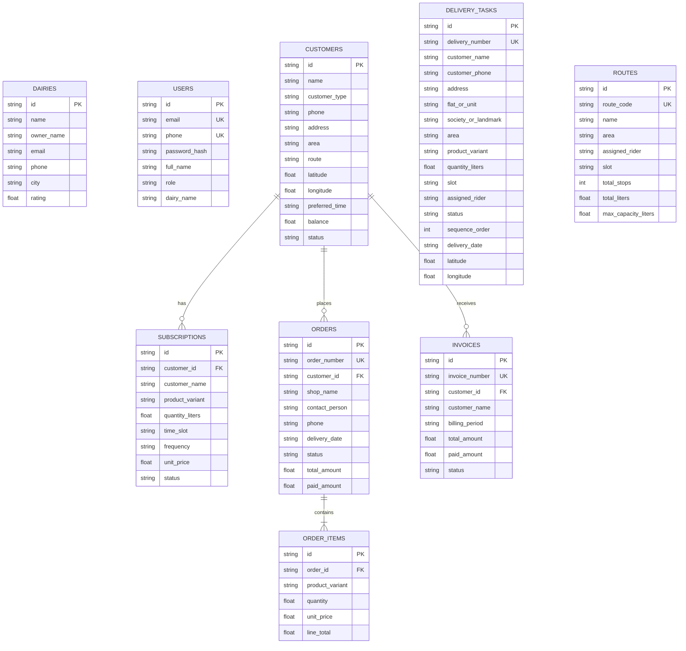

# DairyPulse — Database Architecture & Entity Relationship Design

This document details the database architecture of DairyPulse based on the SQLAlchemy models defined in `backend/app/models/models.py`.

---

## 1. Database Table Inventory

| Entity / Table | Model Class | Primary Key | Foreign Keys | Key Attributes | Relationships | Purpose |
| :--- | :--- | :--- | :--- | :--- | :--- | :--- |
| **`dairies`** | `Dairy` | `id` (String UUID) | None | `name`, `owner_name`, `email`, `phone`, `city`, `address`, `rating` | None | Multi-dairy farm tenant records |
| **`users`** | `User` | `id` (String UUID) | None | `email` (Unique), `phone`, `password_hash`, `full_name`, `role`, `dairy_name`, `is_active` | None | User accounts for authentication and RBAC |
| **`staff`** | `Staff` | `id` (String UUID) | None | `name`, `role`, `phone`, `assigned_area`, `dairy_name`, `status`, `deliveries_today`, `rating` | None | Delivery riders, plant operators, and managers |
| **`customers`** | `Customer` | `id` (String UUID) | None | `name`, `customer_type`, `phone`, `email`, `address`, `area`, `route`, `latitude`, `longitude`, `preferred_time`, `balance`, `status` | `subscriptions`, `orders`, `invoices` | Master customer directory with GPS and delivery preferences |
| **`products`** | `Product` | `id` (String UUID) | None | `name`, `variant`, `unit`, `fat_content`, `snf_content`, `selling_price`, `cost_price`, `available_stock`, `low_stock_threshold`, `status` | None | Catalog of milk variants with cold chain stock and fat/SNF specs |
| **`stock_receipts`** | `StockReceipt` | `id` (String UUID) | None | `supplier_name`, `receipt_date`, `variant`, `quantity`, `unit_cost`, `notes` | None | Batch intake records from dairy farmers/tankers |
| **`inventory_transactions`** | `InventoryTransaction` | `id` (String UUID) | None | `date`, `timestamp`, `transaction_type` (`RECEIPT`, `DISPATCH`, `WASTAGE`), `product_variant`, `quantity`, `rate_per_liter`, `notes` | None | Complete ledger tracking every liter in and out of the hub |
| **`subscriptions`** | `Subscription` | `id` (String UUID) | `customer_id` ➔ `customers.id` | `customer_name`, `product_variant`, `quantity_liters`, `time_slot`, `frequency`, `unit_price`, `status`, `start_date` | `customer` | Active recurring daily delivery contracts |
| **`orders`** | `Order` | `id` (String UUID) | `customer_id` ➔ `customers.id` | `order_number` (Unique), `shop_name`, `contact_person`, `phone`, `delivery_date`, `status`, `total_amount`, `paid_amount` | `customer`, `items` | Commercial B2B bulk milk orders |
| **`order_items`** | `OrderItem` | `id` (String UUID) | `order_id` ➔ `orders.id` | `product_variant`, `quantity`, `unit`, `unit_price`, `line_total` | `order` | Line items belonging to commercial orders |
| **`delivery_tasks`** | `DeliveryTask` | `id` (String UUID) | None | `delivery_number` (Unique), `customer_name`, `customer_phone`, `address`, `flat_or_unit`, `society_or_landmark`, `area`, `product_variant`, `quantity_liters`, `slot`, `assigned_rider`, `status`, `sequence_order`, `latitude`, `longitude`, `delivery_date` | None | Daily execution tasks assigned to riders in sequential order |
| **`routes`** | `Route` | `id` (String UUID) | None | `route_code` (Unique), `name`, `area`, `assigned_rider`, `slot`, `societies`, `total_stops`, `total_liters`, `max_capacity_liters` | None | Sector distribution routes with vehicle load limits |
| **`invoices`** | `Invoice` | `id` (String UUID) | `customer_id` ➔ `customers.id` | `invoice_number` (Unique), `customer_name`, `customer_type`, `billing_period`, `issue_date`, `due_date`, `total_amount`, `paid_amount`, `status` | `customer` | Monthly billing statements |
| **`expenses`** | `Expense` | `id` (String UUID) | None | `category`, `amount`, `date`, `vendor`, `payment_method`, `notes` | None | Operational cost ledger for fuel, maintenance, packaging |

---

## 2. Verified Entity Relationship (ER) Diagram

---

## 3. Real-World Role of Key Entities

1. **`Customer`**: Stores the household subscriber or shop buyer. Crucially stores `latitude`, `longitude` (for turn-by-turn rider navigation) and `preferred_time` (e.g. `5:30 AM - 6:30 AM`).
2. **`Route`**: Represents a geographic delivery circuit (e.g. `R-04: Baner Morning Express`). Tracks total stops, total liters assigned, and `max_capacity_liters` (e.g. 60.0 L) to protect riders from vehicle overload.
3. **`DeliveryTask`**: The atomic daily delivery ticket for a rider. Contains the explicit `sequence_order` (1st, 2nd, 3rd) assigned in the Route Builder Studio, doorstep flat details, and real-time status (`Pending`, `Assigned`, `Delivered`, `Failed`).
4. **`Product`**: Represents distinct milk types with laboratory specs:
   - Cow Milk: 4.2% Fat, 8.5% SNF (₹62/L)
   - Buffalo Milk: 7.0% Fat, 9.0% SNF (₹78/L)
   - Toned Milk: 3.0% Fat, 8.5% SNF (₹54/L)
   - A2 Desi Cow Milk: 4.5% Fat, 8.8% SNF (₹85/L)
5. **`InventoryTransaction`**: Complete immutable ledger recording every liter received (`RECEIPT`), dispatched (`DISPATCH`), or discarded due to spoilage or container rupture (`WASTAGE`).

---

## 4. Schema Integrity & Recommended Enhancements

- **Current Implementation**: Foreign keys are enforced on `subscriptions.customer_id`, `orders.customer_id`, `order_items.order_id`, and `invoices.customer_id`. Primary keys use standard UUID4 strings.
- **Recommended Improvements**:
  1. Add a direct foreign key from `delivery_tasks.customer_id` ➔ `customers.id` (currently tasks look up customers by phone or name).
  2. Add a composite unique index on `delivery_tasks (customer_phone, delivery_date, slot)` at the database schema level to reinforce the existing application-level idempotency check.
  3. Change monetary amounts (`Float`) to `Numeric(10, 2)` or `Decimal` in PostgreSQL to completely eliminate floating-point rounding artifacts.
