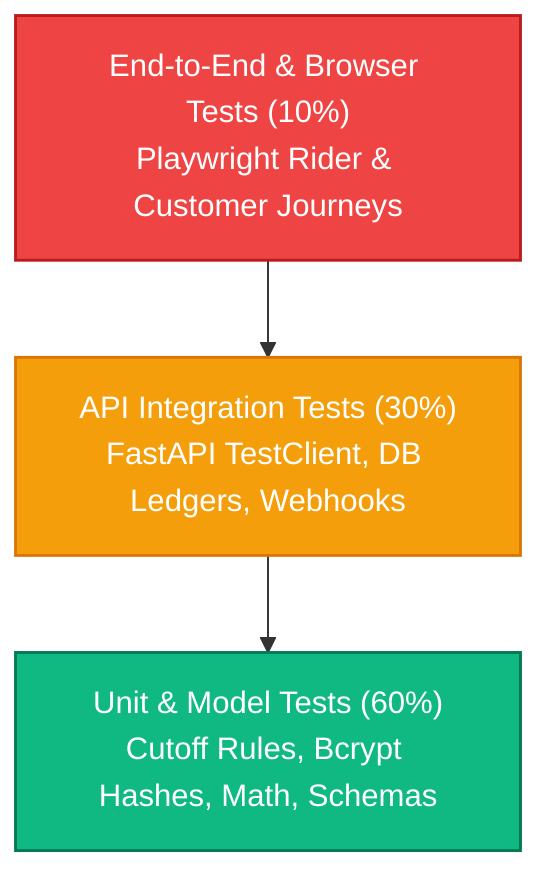

# DairyPulse Comprehensive Testing Strategy

## 1. The DairyPulse Test Pyramid

---

## 2. Test Suites & Coverage Mandate
- **Backend Test Framework:** `pytest` + `pytest-asyncio` + `httpx` (Starlette TestClient).
- **Current Baseline:** 43 passing tests across 5 test files (`test_api.py`, `test_delivery_billing.py`, `test_new_customer_notification.py`, `test_payments_and_security.py`, `test_routing_system.py`, `test_whatsapp_reminders.py`).
- **Pass Rate:** **100% (Zero Tolerance for Broken Tests)**.
- **Frontend Test Suite:** `npm run build` static page prerender check + `tsc --noEmit` type verification.

---

## 3. Required Test Scenarios for Every Module
1. **Happy Path:** Normal flow (e.g. customer subscribes, rider marks delivery, payment clears).
2. **Boundary Conditions:** Time cutoffs (9:59 PM vs 10:01 PM), zero balance vs negative balance.
3. **Data Integrity:** Ledger balance consistency (payments subtract from dues, deliveries add cost).
4. **Failure Modes:** Malformed payload, invalid gateway signature, duplicate daily stops.
