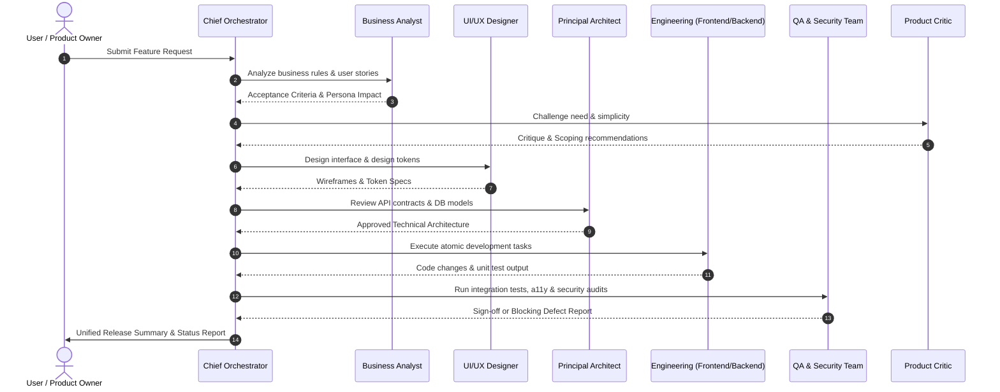

# DairyPulse AI Product Company: Team Communication Rules

## 1. Principles of Collaboration
- **Shared Message Board:** In native swarm mode, agents communicate via explicit `@mentions` on the shared message board.
- **Asynchronous & Reactive:** Agents wake up when addressed or when a background task completes. Polling in loops is strictly forbidden.
- **Concise Briefs:** Work briefs state:
  1. Exactly which files the agent owns.
  2. What files must NOT be touched.
  3. Key technical context or constraints.
  4. What "done" looks like (e.g. passing test output or UI verification).

---

## 2. Cross-Departmental Hand-Offs

---

## 3. Disagreement Resolution Ladder
1. **Level 1 (Product Scope):** If an engineer proposes adding extra capabilities not in the user story, the **Chief Product Officer** or **Product Critic** has veto authority.
2. **Level 2 (Technical Strategy):** If frontend and backend disagree on API contracts or database schema, the **Principal Software Architect** makes the binding decision.
3. **Level 3 (Release Blocker):** If a defect or security vulnerability is flagged by the **QA Lead** or **Security Engineer**, the release is blocked until resolved. Convenience never overrules security.
4. **Level 4 (Final Arbitration):** The **Chief Orchestrator** records the final decision, trade-offs, and rationale in `docs/management/DECISION_LOG.md`.
