# DairyPulse AI Product Company: Team Organization

```mermaid
graph TD
    classDef exec fill:#0F766E,stroke:#115E59,color:#FFFFFF,stroke-width:2px;
    classDef stake fill:#3B82F6,stroke:#1D4ED8,color:#FFFFFF,stroke-width:1.5px;
    classDef market fill:#8B5CF6,stroke:#6D28D9,color:#FFFFFF,stroke-width:1.5px;
    classDef design fill:#F59E0B,stroke:#D97706,color:#FFFFFF,stroke-width:1.5px;
    classDef eng fill:#10B981,stroke:#047857,color:#FFFFFF,stroke-width:1.5px;
    classDef qa fill:#EF4444,stroke:#B91C1C,color:#FFFFFF,stroke-width:1.5px;
    classDef doc fill:#6B7280,stroke:#374151,color:#FFFFFF,stroke-width:1.5px;

    Orchestrator["Chief Orchestrator / Company Board"]:::exec

    subgraph "Executive Leadership"
        A1["Agent 1: Founder & CEO"]:::exec
        A2["Agent 2: Chief Product Officer (CPO)"]:::exec
        A3["Agent 3: Chief Technology Officer (CTO)"]:::exec
        A4["Agent 4: Project Manager / Scrum Master"]:::exec
        A5["Agent 5: Lead Business Analyst"]:::exec
    end

    subgraph "Customer & Stakeholder Board"
        A6["Agent 6: Dairy Owner Rep"]:::stake
        A7["Agent 7: Household Customer Rep"]:::stake
        A8["Agent 8: Delivery Rider Rep"]:::stake
        A9["Agent 9: Dairy Staff Rep"]:::stake
        A10["Agent 10: Platform Admin Rep"]:::stake
    end

    subgraph "Strategy & Market Research"
        A11["Agent 11: Market Research Analyst"]:::market
        A12["Agent 12: Competitor Analyst"]:::market
        A13["Agent 13: Business & Finance Analyst"]:::market
        A14["Agent 14: Product Critic (Independent)"]:::market
    end

    subgraph "Design & UX Department"
        A15["Agent 15: UX Researcher"]:::design
        A16["Agent 16: UI/UX Product Designer"]:::design
        A17["Agent 17: Design System Engineer"]:::design
        A18["Agent 18: Accessibility & Visual Critic"]:::design
    end

    subgraph "Software Engineering Department"
        A19["Agent 19: Principal Software Architect"]:::eng
        A20["Agent 20: Senior Frontend Developer"]:::eng
        A21["Agent 21: Senior Backend Developer"]:::eng
        A22["Agent 22: Database & Data Architect"]:::eng
        A23["Agent 23: API & Integrations Engineer"]:::eng
        A24["Agent 24: Payment & Fintech Engineer"]:::eng
        A25["Agent 25: AI & Data Science Engineer"]:::eng
        A26["Agent 26: Mobile & PWA Engineer"]:::eng
        A27["Agent 27: DevOps & SRE Lead"]:::eng
    end

    subgraph "Quality, Security & Performance"
        A28["Agent 28: QA Lead"]:::qa
        A29["Agent 29: Manual QA Tester"]:::qa
        A30["Agent 30: Test Automation Engineer"]:::qa
        A31["Agent 31: Application Security Engineer"]:::qa
        A32["Agent 32: Web Performance Engineer"]:::qa
        A33["Agent 33: Senior Code Reviewer (Ponytail)"]:::qa
        A34["Agent 34: Technical Debt Manager"]:::qa
    end

    subgraph "Release & Documentation"
        A35["Agent 35: Technical Docs Engineer"]:::doc
        A36["Agent 36: Release Manager"]:::doc
        A37["Agent 37: Customer Support Specialist"]:::doc
    end

    Orchestrator --> A1
    Orchestrator --> A2
    Orchestrator --> A3
    Orchestrator --> A4
    Orchestrator --> A14
    Orchestrator --> A28
    Orchestrator --> A36

    A2 --> A5
    A2 --> A6
    A2 --> A7
    A2 --> A8
    A2 --> A9
    A2 --> A10
    A2 --> A11
    A2 --> A12
    A2 --> A13
    A2 --> A15
    A2 --> A16

    A3 --> A17
    A3 --> A19
    A3 --> A20
    A3 --> A21
    A3 --> A22
    A3 --> A23
    A3 --> A24
    A3 --> A25
    A3 --> A26
    A3 --> A27

    A28 --> A29
    A28 --> A30
    A28 --> A31
    A28 --> A32
    A28 --> A33
    A28 --> A34

    A36 --> A35
    A36 --> A37
```

---

## Departmental Roster & Headcount

| Department | Headcount | Key Leads | Primary Mission |
| :--- | :---: | :--- | :--- |
| **Executive Leadership** | 5 | CEO, CPO, CTO, PM, BA | High-level strategy, sprint governance, architecture oversight |
| **Stakeholder Representatives** | 5 | Dairy Owner, Customer, Rider, Staff, Admin | Authentic stakeholder critique and usability validation |
| **Strategy & Market Research** | 4 | Market Analyst, Fin Analyst, Product Critic | Market sizing, competitive parity, independent challenge |
| **UI/UX & Design** | 4 | Lead Designer, UX Researcher, Token Engineer | High-density agricultural design, a11y, mobile workflows |
| **Software Engineering** | 9 | Architect, Backend, Frontend, DB, Fintech, ML, DevOps | Robust FastAPI/Next.js/SQLAlchemy implementation |
| **Quality, Security & QA** | 7 | QA Lead, Automation, AppSec, Reviewer | 100% test pass rate, OWASP compliance, zero technical debt |
| **Documentation & Release** | 3 | Docs Engineer, Release Manager, Support | Developer onboarding, release runbooks, customer FAQs |
| **Total Organization** | **37** | **Chief Orchestrator** | Complete AI Product Company |
