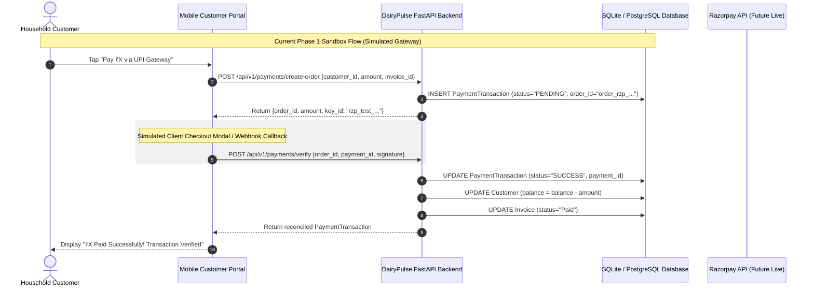

# DairyPulse Payment Architecture & Gateway Integration Audit

**Auditors:** Payment & Fintech Engineer (Agent 24), Application Security Engineer (Agent 31), Independent Product Critic (Agent 14)  
**Date:** November 14, 2026  
**Status:** **INDEPENDENT VERIFICATION COMPLETE**  

---

## 1. Executive Payment Classification

**Core Determination:**
The current payment functionality in DairyPulse is classified as:

> **Category A: Recorded Locally Only (Simulated Sandbox Gateway Flow with Local Ledger Reconciliation)**

### Proof & Verification Evidence:
1. **Order Creation (`POST /api/v1/payments/create-order`):**
   - Implemented in `backend/app/routers/api_v1.py#L3420-L3463`.
   - The endpoint generates an internal UUID-based order string: `order_id = f"order_rzp_{uuid.uuid4().hex[:14]}"`.
   - **No Outbound Network Request:** It does NOT call the Razorpay REST API (`https://api.razorpay.com/v1/orders`) or Cashfree API via HTTP client. No external network request occurs.
   - It records a `PaymentTransaction` in `payment_transactions` with status `PENDING` and returns test metadata.
2. **Signature Verification (`POST /api/v1/payments/verify`):**
   - Implemented in `backend/app/routers/api_v1.py#L3465-L3502`.
   - **No Cryptographic HMAC Check:** The endpoint accepts arbitrary `req.signature` or falls back to `sig_verified_{uuid}`. It does NOT compute `hmac.new(RAZORPAY_KEY_SECRET, f"{order_id}|{payment_id}", hashlib.sha256).hexdigest()`.
   - It performs local ledger reconciliation: marks transaction `SUCCESS`, deducts `customer.balance`, and sets `invoice.status = "Paid"`.
3. **Settlement Status:**
   - **Not Category B (Live Gateway Collection):** No real money moves over Indian banking rails (IMPS/UPI/NEFT).
   - **Not Category C (Settled to Platform Account):** DairyPulse platform holds no nodal or escrow account.
   - **Not Category D (Direct Dairy Owner Routing):** Dairy owner UPI IDs are stored as strings (`dairies.upi_id`), but no merchant onboarding API (Razorpay Route / Linked Accounts) is integrated.
   - **Not Category E (Marketplace Split-Settlement):** No RBI-compliant PA-PG split escrow engine is implemented.

---

## 2. End-to-End Payment Sequence Diagram



---

## 3. Critical Security Gaps & Vulnerabilities in Payment Flow

| Vulnerability ID | Vulnerability Description | Severity | Location in Code | Remediation Requirement |
| :--- | :--- | :---: | :--- | :--- |
| **PAY-SEC-01** | **Unverified Signature Bypass:** Client can forge arbitrary `payment_id` and `signature` to mark orders `SUCCESS` and wipe out real milk debts without paying. | **CRITICAL** | `api_v1.py#L3481` | Mandate HMAC-SHA256 signature verification using `settings.RAZORPAY_KEY_SECRET`. |
| **PAY-SEC-02** | **Unauthenticated Verification Endpoint:** Anyone knowing an `order_id` can trigger `/payments/verify` without customer or owner auth headers. | **HIGH** | `api_v1.py#L3465` | Require authenticated customer session matching `tx.customer_id` or owner token. |
| **PAY-SEC-03** | **Missing Gateway Webhook Endpoint:** No dedicated `/payments/webhook` listener verifying the `X-Razorpay-Signature` header for asynchronous server-to-server callbacks. | **HIGH** | `api_v1.py` | Implement dedicated webhook handler with raw payload signature validation. |
| **PAY-SEC-04** | **Missing Refund Architecture:** No backend endpoint exists to reverse transactions (`POST /payments/{id}/refund`), handle chargebacks, or adjust ledger credits. | **MEDIUM** | `api_v1.py` | Implement refund endpoint linked to Razorpay Refund API and reverse customer credit. |
| **PAY-SEC-05** | **Absence of Idempotency Key:** Duplicate network retries on verify endpoint could cause race conditions in high-concurrency environments. | **MEDIUM** | `api_v1.py#L3477` | Wrap ledger updates in database transaction with row-level lock (`with_for_update()`). |

---

## 4. Path to Production Gateway Enablement (Sprint 1 & Sprint 2)
1. **Live Gateway Client:** Install official `razorpay` Python library in `backend/requirements.txt`.
2. **Real Order Creation:** Replace local order ID minting with `client.order.create({"amount": int(amount * 100), "currency": "INR", "receipt": order_id})`.
3. **HMAC Cryptographic Validation:**
   ```python
   # Mandatory Production Check
   generated_signature = hmac.new(
       settings.RAZORPAY_KEY_SECRET.encode("utf-8"),
       f"{req.order_id}|{req.payment_id}".encode("utf-8"),
       hashlib.sha256
   ).hexdigest()
   if not hmac.compare_digest(generated_signature, req.signature):
       raise HTTPException(status_code=400, detail="Invalid gateway signature")
   ```
4. **Merchant Onboarding:** Store verified sub-merchant account IDs on the `Dairy` model so payments route directly to each dairy owner's bank account.

