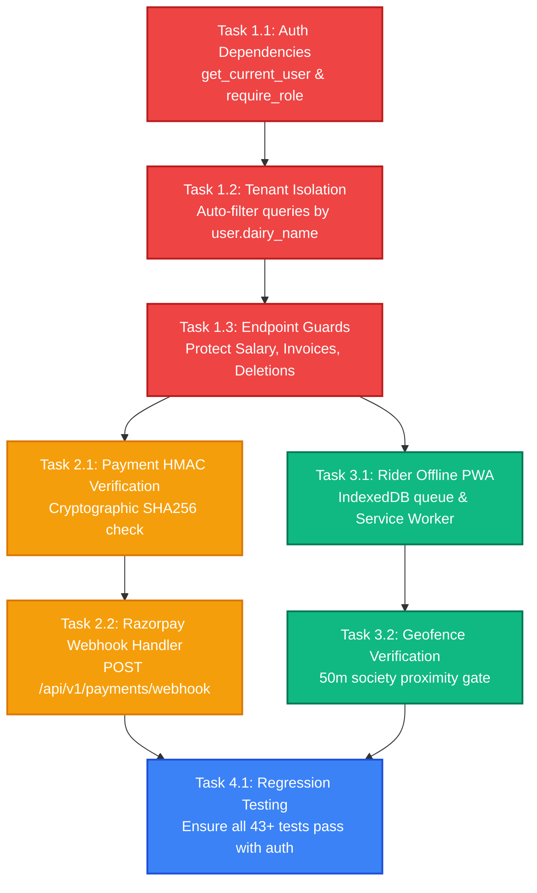

# DairyPulse Sprint 1 Revised Plan & Safe Execution Sequence

**Prepared By:** Chief Product Officer (Agent 2), CTO (Agent 3), QA Lead (Agent 28), Senior Code Reviewer (Agent 33)  
**Date:** November 14, 2026  
**Sprint Duration:** 2 Weeks (November 15 – November 29, 2026)  
**Sprint Theme:** **"Perimeter Security & Offline Field Hardening"**  

---

## 1. Prioritized Findings from Mission 001

| Rank | Finding ID | Severity | Problem Statement | Sprint 1 Action |
| :---: | :--- | :---: | :--- | :--- |
| **1** | **SEC-01** | **CRITICAL** | Zero API endpoints enforce JWT authorization or role checks. Anyone can execute salary payouts or delete customers without a token. | Implement `get_current_user` and `require_role` FastAPI dependencies. Secure sensitive endpoints. |
| **2** | **SEC-02** | **CRITICAL** | Multi-tenant isolation failure: Omitting `?dairy_name=` leaks all customers, expenses, and invoices globally. | Enforce server-side tenant scoping from verified JWT payload. |
| **3** | **PAY-01** | **HIGH** | Payment order verification accepts arbitrary signatures without HMAC-SHA256 validation. | Implement cryptographic HMAC verification using `RAZORPAY_KEY_SECRET`. |
| **4** | **MOB-01** | **HIGH** | Field delivery riders risk losing morning drop data when entering apartment elevators with zero network. | Implement IndexedDB offline action queue and Service Worker in `/mobile/delivery`. |
| **5** | **OPS-01** | **MEDIUM** | Riders can theoretically mark deliveries delivered while still at depot. | Implement GPS geofence check (maximum 75m from society pin). |

---

## 2. Revised Sprint 1 Work Breakdown & Safe Execution Sequence

---

## 3. Detailed Task Specifications

### Task 1: Reusable Authorization Dependencies & Endpoint Protection
- **Assigned Agents:** Application Security Engineer & Backend Developer.
- **Implementation:**
  - Create `backend/app/auth/dependencies.py` implementing `get_current_user(token = Depends(oauth2_scheme))` and `require_role(["OWNER", "ADMIN"])`.
  - Attach `Depends(require_role(["OWNER", "ADMIN"]))` to:
    - `POST /salary/payout`
    - `PATCH /staff/{id}/daily-salary`
    - `DELETE /customers/{id}`
    - `DELETE /products/{id}`
    - `POST /invoices`
    - `POST /billing/settings/reminders`
  - Update `backend/tests/conftest.py` with standard authenticated headers (`Authorization: Bearer <valid_jwt>`) to keep all 43 tests passing.

### Task 2: Multi-Tenant Data Isolation Enforcement
- **Assigned Agents:** Database Architect & Backend Developer.
- **Implementation:**
  - Update `get_customers`, `get_expenses`, `get_invoices`, `get_orders` to automatically filter by `current_user.dairy_name` unless user has `ADMIN` role.
  - Reject queries attempting to access resources belonging to a foreign dairy brand with HTTP 403 Forbidden.

### Task 3: Cryptographic Payment Signature Verification & Webhook
- **Assigned Agents:** Payment & Fintech Engineer.
- **Implementation:**
  - In `POST /payments/verify`, compute SHA-256 HMAC of `f"{order_id}|{payment_id}"` against `RAZORPAY_KEY_SECRET`.
  - Reject requests with invalid signatures with HTTP 400 Bad Request.
  - Implement dedicated `POST /payments/webhook` with `X-Razorpay-Signature` validation.

### Task 4: Rider Mobile PWA Offline Queue
- **Assigned Agents:** Mobile & PWA Engineer & Frontend Developer.
- **Implementation:**
  - Register PWA Service Worker caching static assets.
  - Store marked delivery actions (`status`, `timestamp`, `latitude`, `longitude`) in IndexedDB when `navigator.onLine === false`.
  - Auto-dispatch queued actions to `POST /deliveries/batch-sync` upon `online` window event.

---

## 4. Sprint 1 Exit Criteria (Definition of Done)
1. **Zero Unauthenticated Administrative Endpoints:** All salary, deletion, and financial routes reject unauthenticated requests with HTTP 401/403.
2. **Multi-Tenant Leak Proof:** `GET /customers` never returns customers belonging to another dairy.
3. **Cryptographically Verified Payments:** Payment verification fails when signature does not match gateway HMAC secret.
4. **100% Test Pass Rate:** All 43 existing backend tests plus new security tests pass.
5. **Zero Build Errors:** `tsc --noEmit` and `npm run build` pass with 0 errors.

